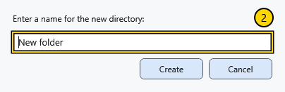

# Create a file or folder

Create objects only in a folder you can write to. Check the current address first. A file-creation dialog has its own destination: verify it separately.

## Create a folder

1. Go to the parent folder and choose **Create folder** on the toolbar or background menu.
2. Enter one folder name and confirm creation. Use **Cancel** to leave without creating it.

Empty names, path separators and invalid characters are rejected. An existing folder with the same name produces an error; it is not replaced. Correct the name and try again. Verify that the new folder appears under the intended parent.

## Create a file

Choose **Create file**. In the document dialog check the destination, type, filename and template, then confirm. The created document opens in its editor; an unsaved current document may require a decision first. See the document-creation article for formats, page options and attributes.

Invalid or reserved names, path separators and trailing dots or spaces are rejected with an error; no substitute file is created. Correct the name in the open dialog and try again. An occupied valid name can still produce a standard free name: check the actual name and path after creation.

## Selection dialogs

The same manager can open as a file or folder picker. Its bottom action confirms the selection and **Cancel** returns without choosing. A folder picker confirms the indicated folder; ordinary manager **Open** opens an object. Check the title, path and confirmation button before continuing.

## Related topics

- [Create and save a document](help:doc.create)
- [Resolve name conflicts](help:files.conflicts)
