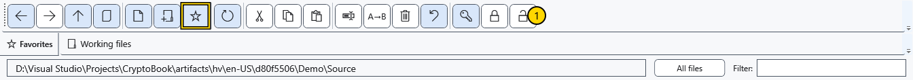

# Favorite folders

Favorites are shortcuts to folders in the file manager. They do not copy a folder, pin a document or set the search workspace.

## Add and open

1. Navigate to the folder you need and click the star on the toolbar. Its shortcut appears in the favorites strip.

Click a shortcut to open its folder and verify the address. Adding the same folder again does not create another physical folder. The path, not the displayed nickname, determines the destination.

## Rename or remove a shortcut

Right-click the favorite and choose **Rename**. Enter a display name and save; **Cancel** abandons the change. This changes only the favorite label, not the real folder name or path. Use **Remove from favorites** in the context menu to remove the shortcut: the folder and its contents remain on disk.

## If the folder is unavailable

An unavailable favorite cannot be opened. Restore access to the disk or folder, then reopen the manager to refresh availability. Renaming the label cannot repair a moved folder. Navigate to the correct folder, remove the old shortcut and add the current one. For files you regularly edit, use pinned documents instead.

## Related topics

- [Navigate folders](help:files.navigate)
- [Pinned documents](help:files.pinned)
