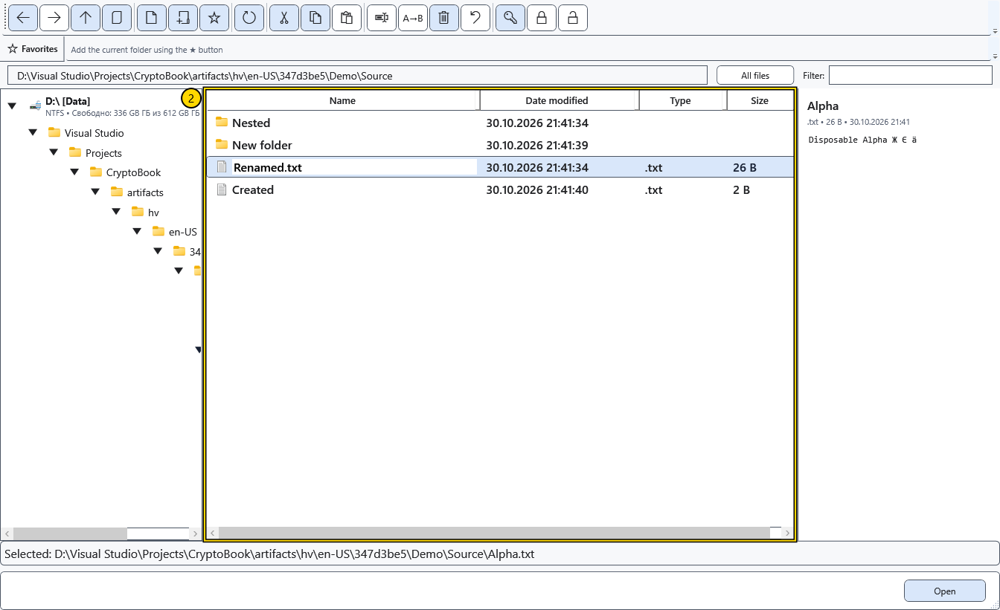

# Open, rename and delete

The selected row determines which object a command uses. Keep a separate copy before changing important files. Local deletion asks for confirmation and moves files and folders to the Windows Recycle Bin.

## Open or copy a path

Double-click a folder to enter it. For a file use **Open**: supported documents open in CryptoBook, while other supported actions can use an external application. **Open with** invokes the system application choice for one local file. **Show in File Explorer** shows a local object in Windows File Explorer. These shell actions require a suitable local object and Windows support.

**Copy path** puts one or more selected paths on separate lines in the Windows clipboard. It does not copy file contents. Inspect the selection and the local/device address before using the text elsewhere.

## Rename one object

1. Select exactly one file or folder and choose **Rename**.
2. Edit the name in the row. If you omit an extension, the original extension is retained automatically. An explicit extension replaces the old one. To intentionally remove an extension, use multi-rename with an empty extension mask.

3. Press Enter to apply. Esc requests confirmation to abandon the edit; confirm that cancellation to restore the previous name. On failure the old name is restored and an error is shown.

After success, refresh and check the full path. Single renaming updates the matching active document and pinned/recent references; a separate warning can report a failed reference update. Folder trees and external shortcuts are not a universal document-link tracker. Two or more local files use the separate multi-rename tool.

## Delete

Select local objects, choose **Delete** and confirm the selection. **Cancel** in the confirmation leaves files in place. Objects enter the Windows Recycle Bin with their original names; no sibling folders are created to store deleted files. If recycling is unavailable, an error is shown; the app does not substitute permanent deletion.

To return them, open the Windows **Recycle Bin**, select the objects and choose **Restore**. They return to their original folders. Canceling a running multi-item deletion or encountering an error may leave some objects in the bin and others in place. Return completed items using the Recycle Bin. Emptying the bin or permanently deleting items from it removes this normal recovery option.

Android and other remote sources retain a separate permanent-deletion warning. In a mixed selection, local objects enter the bin while remote objects follow device rules.

## Recover interrupted operations

The **Restore operations** toolbar button is available only when the open folder contains a pending recovery journal. It is disabled while restoring and after successful completion. Journals are checked when navigating, refreshing the list and completing a file operation. For an interrupted transfer, open the destination folder; for multi-rename, open the first source file's folder. This button does not return objects from the Windows Recycle Bin.

Objects retained in a sibling recovery folder by a previous build can still be returned with this button from the folder containing their old journal.

## Related topics

- [Rename multiple files](help:files.batch)
- [Source capabilities and limits](help:devices.limits)
- [Two editors, renaming and closing](help:doc.switch)
