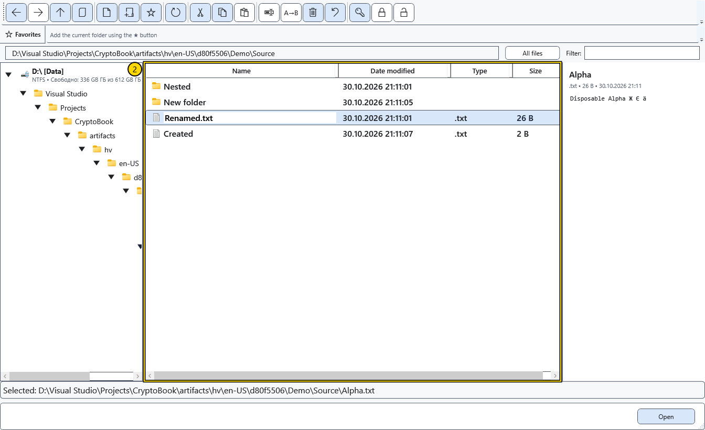

# Open, rename and delete

The selected row determines which object a command uses. Keep a separate copy before changing important files. Local deletion checks the available Recycle Bin capacity and asks you to confirm the deletion mode.

## Open or copy a path

Double-click a folder to enter it. For a file use **Open**: supported documents open in CryptoBook, while other supported actions can use an external application. **Open with** invokes the system application choice for one local file. **Show in File Explorer** shows a local object in Windows File Explorer. These shell actions require a suitable local object and Windows support.

**Copy path** puts one or more selected paths on separate lines in the Windows clipboard. It does not copy file contents. Inspect the selection and the local/device address before using the text elsewhere.

## Rename one object

1. Select exactly one file or folder and choose **Rename**.
2. Edit the name in the row. If you omit an extension, the original extension is retained automatically. An explicit extension replaces the old one. To intentionally remove an extension, use multi-rename with an empty extension mask.

3. Press Enter to apply. Esc requests confirmation to abandon the edit; confirm that cancellation to restore the previous name. On failure the old name is restored and an error is shown.

After success, refresh and check the full path. Single renaming updates the matching active document and pinned/recent references; a separate warning can report a failed reference update. Folder trees and external shortcuts are not a universal document-link tracker. Two or more local files use the separate multi-rename tool.

## Delete

Select local objects and choose **Delete**. The app first totals the entire selection and compares it with the available Recycle Bin quota on each volume. If it fits, confirm recycling. If the entire selection does not fit or there is no Recycle Bin, a separate warning offers to permanently delete **all selected objects**. Nothing is deleted before confirmation; **Cancel** leaves the entire selection in place. If the quota cannot be determined, the operation stops with a message. The app does not itself empty old items from the bin.

To return them, open the Windows **Recycle Bin**, select the objects and choose **Restore**. They return to their original folders. Canceling a running multi-item deletion or encountering an error may leave some objects in the bin and others in place. Return completed items using the Recycle Bin. Emptying the bin or permanently deleting items from it removes this normal recovery option.

Android and other remote sources retain a separate permanent-deletion warning. In a mixed selection, local objects enter the bin while remote objects follow device rules.

## Recover interrupted operations

The **Restore operations** toolbar button is available only when the open folder contains a pending recovery journal. It is disabled while restoring and after successful completion. Journals are checked when navigating, refreshing the list and completing a file operation. For an interrupted transfer, open the destination folder; for multi-rename, open the first source file's folder. This button does not return objects from the Windows Recycle Bin.

Objects retained in a sibling recovery folder by a previous build can still be returned with this button from the folder containing their old journal.

## Working with archives

Select local files or folders and choose **Create archive…** on the toolbar or context menu. Choose a destination folder, a new archive name and ZIP or 7z. An optional password enables AES-256; ZIP passwords require 1–99 printable ASCII characters. Choose 7z for Unicode passwords.

For one ZIP, 7z, RAR or RAR5, use **Extract archive…** or **Test archive…**. Extraction creates a new folder; existing files and folders are never replaced. Choose a new name if it already exists. The default extraction limit is 20 GiB and can be changed in the dialog. The progress window allows cancellation. An error or cancellation prevents the final result from being created; if temporary files are locked, the message identifies their folder.

The archive password is separate from the CryptoBook key, is not saved and is cleared from the field when the operation starts. Enter it again after an error. An integrity check is not a malware scan. Android/MTP, network paths, RAR creation and editing inside archives are not supported yet. Links and unsafe names are rejected.

Double-click ZIP, 7z or RAR to browse it as a folder in FileExplorer, or choose **Open archive**. In the tree, this folder appears inside the directory containing the source archive. History, Up, filtering and text/image preview are available. Protected archives prompt for a password. The title indicates read-only mode.

To extract selected content, use **Copy**, navigate to a local folder and choose **Paste**. Keep the source window open until completion. The selected object is limited to 20 GiB; choose Keep both or Skip on conflicts. Replacement, editing entries, All files mode and nested archives are unavailable. Preview does not write decoded data to disk. Closing the window releases the password and the source lock.

## Related topics

- [Rename multiple files](help:files.batch)
- [Source capabilities and limits](help:devices.limits)
- [Two editors, renaming and closing](help:doc.switch)
