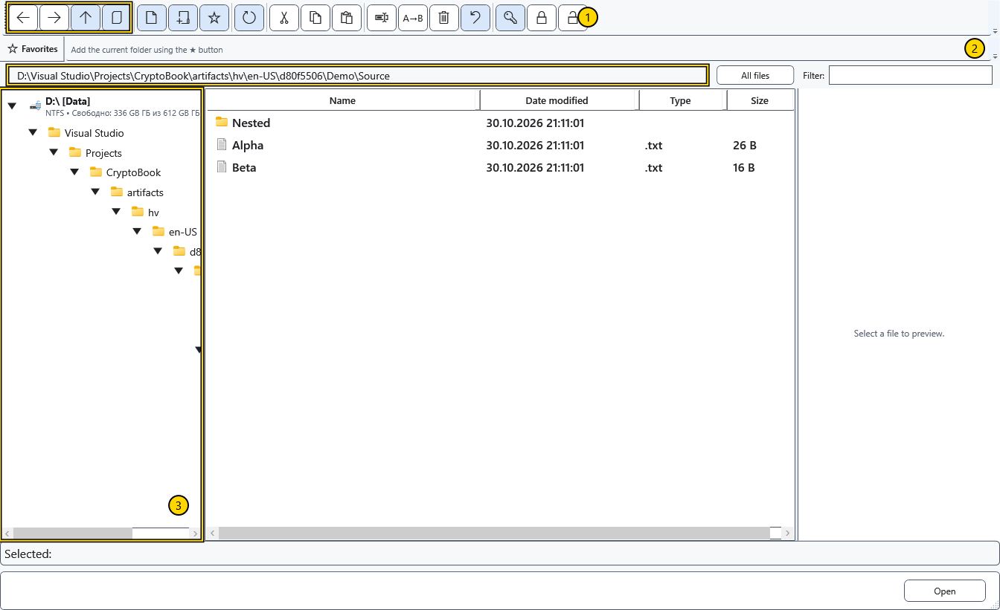
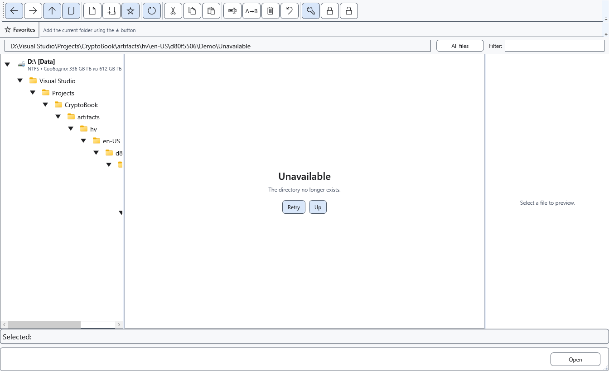

# Navigate folders

The file manager has its own current folder and navigation history. Browsing does not change the workspace used for searches or the document already open in the editor.

## Choose a folder

1. Open the file manager from the document menu. Select a drive and folder in the left tree; expand a branch with its arrow. Double-click a folder in the list to enter it.
2. Alternatively, enter a full local folder path in the address bar and press Enter. Esc restores the current address without navigating.
3. Use the toolbar arrows to go back, forward or to the parent folder. **Show current document** goes to the folder of the document that has a saved path. **Refresh** rereads the current folder.

The numbered areas are 1 — navigation buttons, 2 — address, 3 — folder tree. Check the address before creating, pasting or deleting anything. A folder selected in the tree and files selected in the list serve different commands.

## If the folder is unavailable

The list can show an unavailable-folder panel. Check the path, disk connection and permissions, restore access and use the retry button. You can also go up to an accessible parent. An empty or unavailable view does not prove that the files were deleted.

Close the manager to return to your document. Closing it does not undo file operations already completed. Device addresses and capabilities differ from local paths; do not enter a device locator as an ordinary Windows path.

## Related topics

- [Choose a workspace directory](help:start.workspace)
- [Android devices](help:devices.android)
- [Sort, filter and select files](help:files.views)
