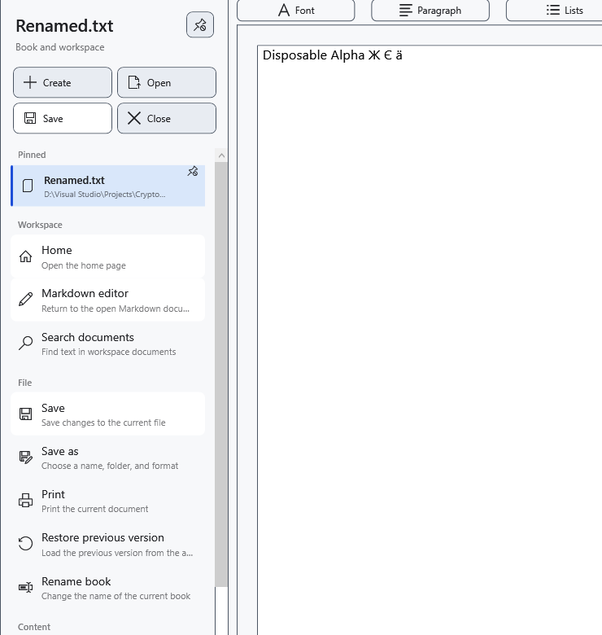

# Pinned documents

Pin a document to keep its file link in the side menu. Pinning does not save edits or create a backup. The document needs a usable saved path.

1. Open the document and expand the side menu. Choose **Pin current document** in the quick actions. The file appears under **Pinned**; the same control becomes **Unpin current document**.

Click the pinned file to open it. The active entry and unsaved state are indicated separately from availability. Opening another document can ask what to do with unsaved edits; canceling that decision keeps the current document.

## Manage the list

Right-click an entry. **Move up** and **Move down** change only the list order. **Show in File Explorer** shows the local file in Windows. Opening the context menu refreshes availability. **Remove from pinned** removes only the link and leaves the file intact.

## Find a moved file

If the file is missing, first reconnect its disk. Use **Choose new location…** for a genuinely moved file and choose its existing new location; canceling the picker keeps the old reference. This repairs the link without moving the file. Check the filename and contents so that you do not attach an unrelated file.

Single and batch renaming in the manager update matching current, pinned and recent paths. If a reference-saving warning appears, check the actual disk path and repair the link. Do not assume that arbitrary external moves are tracked automatically.

## Related topics

- [Recent documents](help:files.recent)
- [Two editors, renaming and closing](help:doc.switch)
