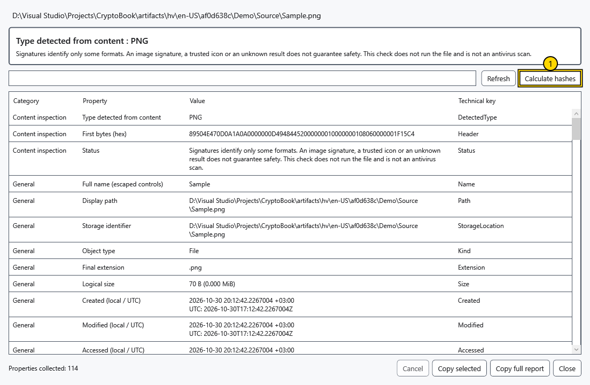
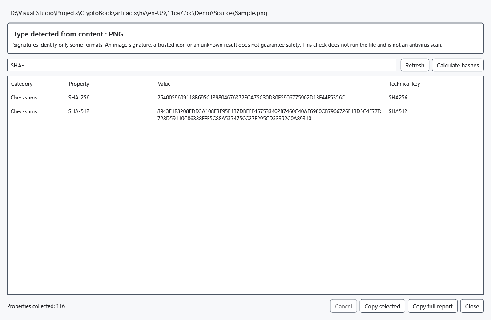

# Detailed properties and hashes

The detailed report inspects a selected object without executing it. It helps compare files and notice a mismatch between filename and content. A recognized format or valid signature does not guarantee harmless contents.

1. Select one file and choose **Detailed properties** in its context menu, or press Alt+Enter with focus in the file list. A folder has the context-menu command. **Properties** is a separate Windows properties action.
2. Wait for reading to finish. The detected type is based on supported file headers, not just the extension. Unknown formats and failed sections are reported without discarding other available properties.

The marked button calculates hashes. For a local file the report can include size, local/UTC dates, attributes, link target, allocated space, volume/file identifiers, hard links, owner and saved access rules. The rules are not a calculation of your effective permissions. NTFS data streams and limited Zone.Identifier text, Windows Property System values, media/EXIF and document metadata depend on the filesystem, installed handlers and access rights.

For supported executables it also reads version, PE/CLR information and signatures without loading the file as a program. Signature checks use locally available information without online revocation refresh; certificate details and trust result are separate. ZIP/OLE detection identifies a container, not safe archive contents. An encrypted .cbook is inspected as a container without automatic decryption.

Names supplied by Windows property handlers may follow the Windows language; technical keys and stored values are shown as supplied.

## Hash and copy

3. Choose **Calculate hashes** for SHA-256 and SHA-512 in one reading pass. Compare the entire values with a trustworthy reference for exactly the same file. **Cancel** stops work cooperatively; already running native Windows calls can take longer to return. A file being written or changing during reading can produce an error; close the writer and retry.

Enter part of a section, property name, value or technical key in the search field. Clear it to show all rows. Select rows with Ctrl/Shift and use **Copy selected**, or **Copy full report** for every collected property even while filtered. **Refresh** rereads properties; calculate hashes again afterward. Close the window to return without changing the inspected file.

Remote sources provide only available object metadata. Full content inspection, Windows/NTFS data, signatures and hashes require a local copy. Missing fields can reflect format, handler or permission limits; this report is neither an antivirus scan nor a universal inventory of every internal format field.

## Related topics

- [Source capabilities and limits](help:devices.limits)
- [Protected file compatibility](help:security.compatibility)
