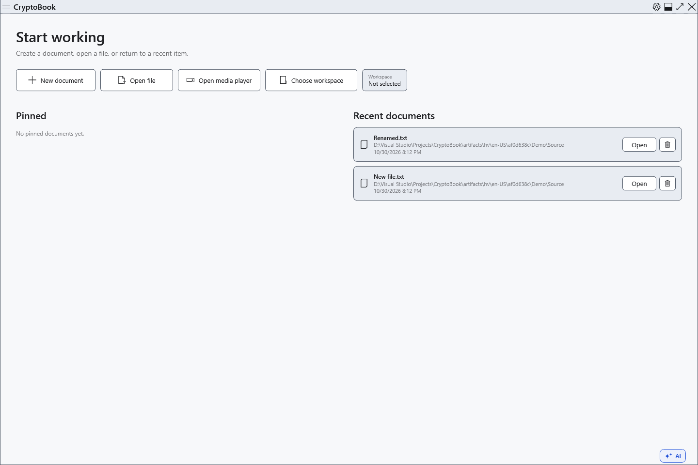

# Recent documents

The start screen lists documents after a successful open or save. This is a history of file references, not saved copies or an archive of document contents.

1. Close the current document after resolving any unsaved changes to return to the start screen. Look under **Recent documents**.

Click a recent document to open its current file. Check the name and parent folder, especially when several files share a name. A history entry does not guarantee that the disk is connected or the original file still exists.

## Missing or moved files

Reconnect the disk first. For a moved file choose **Locate…** and select its existing new location. Cancel the picker to keep the previous reference. Choosing a new location updates the reference; it does not restore deleted contents or move the file. Pinned and recent lists are distinct, so check both when repairing references manually.

Use **Remove from history** to remove an entry you no longer need. The physical file remains; opening or saving it successfully can add it to history again. Removing an entry is not deleting a document. For a deliberately maintained quick-access list, pin the document in the side menu.

If the history cannot be updated, the open file and the stored reference are separate results. Check the actual path and the operation message instead of treating an old entry as evidence of a failed file save.

## Related topics

- [Pinned documents](help:files.pinned)
- [Open a document](help:doc.open)
