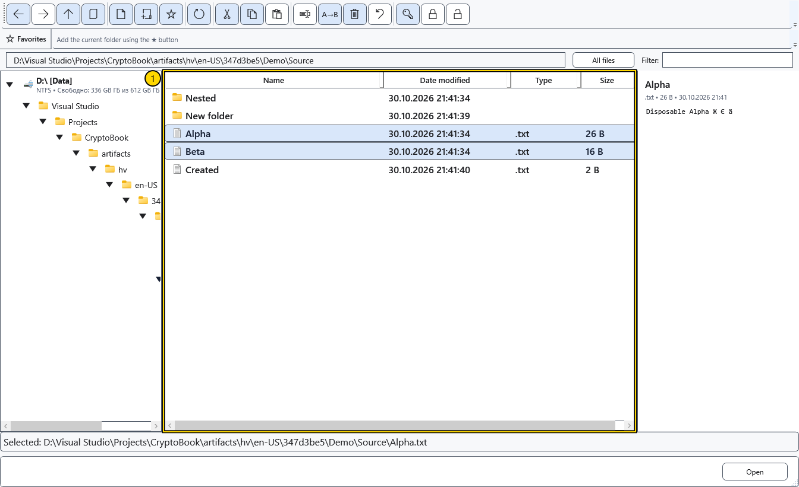

# Copy and move files

These steps apply to local files and folders. Keep a separate copy before transferring important data and check both source and destination. On cancellation or failure, CryptoBook restores the local batch using its journal.

1. Select the source rows with Ctrl or Shift. Choose **Copy** to retain the originals, or **Cut** to move them. These commands remember a file operation inside CryptoBook; **Copy path** instead copies text to the Windows clipboard.

2. Navigate to the destination folder and choose **Paste**. Alternatively use **Move** on the source selection and choose the destination in the folder picker; canceling that picker leaves the files in place. Resolve name conflicts before the transfer starts.
3. Wait for the progress window to finish. **Cancel** or closing that window requests cancellation; the window remains until the running work stops and the view updates.

You can also drag a selection onto a destination folder in the tree or list. Holding Ctrl requests copying; otherwise dragging requests moving. Check the target before releasing. Moving a folder into itself or a descendant is rejected; a drive root is not a normal movable item.

## Check the result

Refresh the destination and open a copied sample. After moving, check both the destination and source. A successful cut/paste clears the remembered move operation. Do not assume that moving a file updates every saved document link; single and batch renaming have their own link updates.

## Cancellation and errors

Cancellation or failure rolls back the whole local batch, including completed items and previous destinations. A move between volumes verifies the copy before removing the preserved source. If an occupied name or external lock blocks rollback, data and the journal are retained; the message identifies the journal folder. Remove the obstruction, open that folder and choose **Restore operations**. After an interrupted process, use the same command in the destination folder. A successfully completed transfer keeps no separate Undo. Device transfers have their own rules.

## Related topics

- [Resolve name conflicts](help:files.conflicts)
- [Device transfers](help:devices.transfers)
