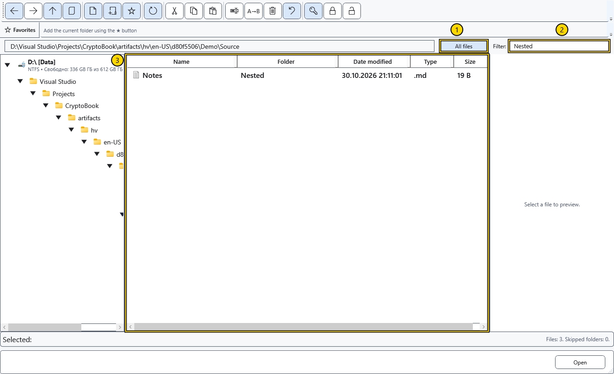

# Sort, filter and select files

Adjust the list before choosing files for an operation. Filtering changes what is visible; it does not move or delete anything.

## Arrange the view

Click a column heading to sort; another click reverses its direction. Name, modified date, type and size are available. Drag a column boundary to change its width. The vertical splitters change the folder, list and preview areas.

Enable **All files** to list files in the current folder and its subfolders. The additional folder column identifies each relative location; folders themselves are not rows in this mode. This view is unavailable when selecting a folder in a picker.

The numbered areas show 1 — recursive view, 2 — filter, 3 — list. Enter text in **Filter:** to match a name (including its extension), or a relative folder in recursive view. Clear the field to restore the list. This is a substring filter, not a search inside document contents.

## Reading and selecting

The status line shows scanning, counts and skipped folders. Use the scan-cancel button to stop reading a large tree; the resulting list may be incomplete. Refresh to try again, or disable **All files** to return to the current folder. Skipped or inaccessible folders are not proof of an empty source.

Click a row for one object, Ctrl-click for separate rows or Shift-click for a range. Check the highlighted rows before using a command; tree, background and row context menus have different targets. A multi-rename counter follows the displayed file order, not the order of your clicks.

## Related topics

- [Navigate folders](help:files.navigate)
- [Rename multiple files](help:files.batch)
- [Find files by name](help:search.name)
