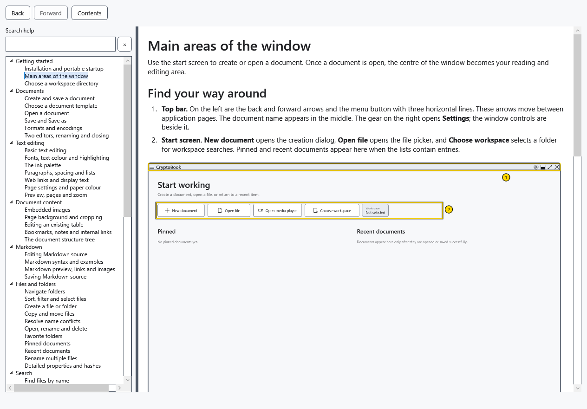
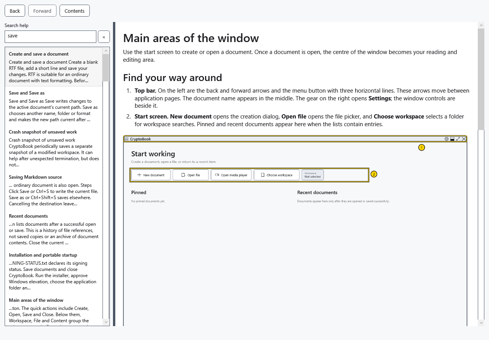
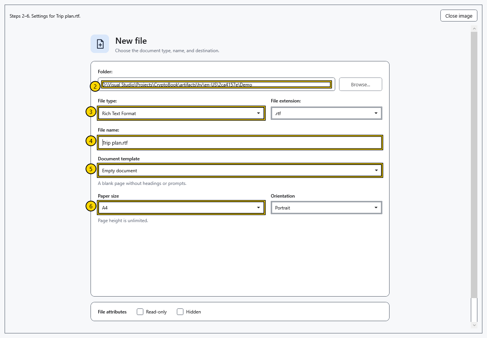

# Help contents, search and illustrations

Built-in help works without a network or an open document. It opens in a separate modeless window, so you can return to your work while keeping an article open.

## Open a topic

1. Select **Help** in the main window's side menu or press **F1** in the main window. Calling it again activates the existing window, including a minimized one.
2. Expand a section on the left and select an article. Drag the divider to resize contents and text; scroll the article to read more.

## Find and return

3. Enter words in **Search help** or press Ctrl+F. Search covers titles, keywords and article text in the current language, requires all words, and does not search your documents.
4. Click a result or select it and press Enter. With no results, shorten the query or try another word.

5. **Contents** and **×** clear the query and restore the tree; they do not switch to the first article. **Back / Forward** or Alt+←/→ navigate topic history and restore reading positions. A new navigation branch replaces the previous forward history.

## Enlarge an illustration

6. Click an illustration, or Tab to its button and press Enter. You can scroll a large image. Close the enlarged image before searching or navigating to another topic.

7. Select **Close image** or press Esc. In the search field, Esc first clears the query, then moves focus to the article when the query is empty. Close the window with its close button or Alt+F4.

The last topic and window size are saved; navigation history lasts only until the window closes. Changing language opens the same topic in translation, clears search and resets reading positions. Markdown help in the editor opens the syntax topic in this same window. If an image is unavailable, use the written steps and report the application version; normal use needs no separate image download.

- [Main window areas](help:start.interface)
- [Application language](help:settings.language)
- [Markdown editor](help:md.edit)
- [Keyboard shortcuts](help:settings.hotkeys)
