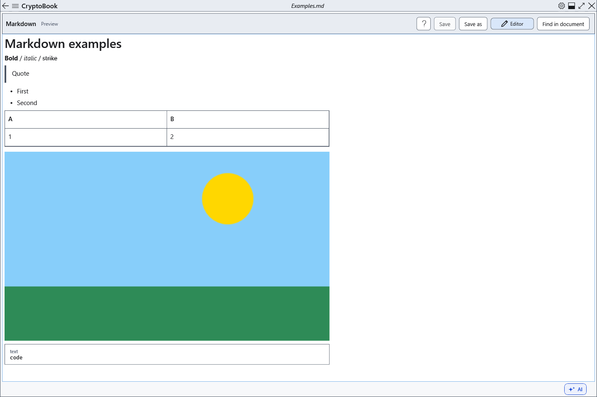

# Markdown preview, links and images

Preview shows a formatted copy of current Markdown. Make changes in the source rather than in the rendered result.

## Steps

1. Click **Preview**. Headings, lists, code and tables are generated from text. Reopen preview after a source edit to refresh it.
2. HTTP/HTTPS web links and mailto links can open through system applications. Relative document links, file: and ftp: links are inactive.
3. Keep an image beside the .md file or in its subfolder and enter ``. Only local relative image paths are allowed, with a 25 MiB file limit and decoding limited to 1600 pixels. Remote and absolute image paths are not loaded.

## Check, undo and limitations

HTML remains inactive text. If an image label appears instead of an image, check the path relative to the Markdown file, the file's presence and size. Move both files together. **Editor** returns to the preserved source. Do not expect unsupported extensions to gain special functionality: tasks, footnotes and formulas do not become full interactive controls or calculations.

## Related topics

- [Markdown syntax and examples](help:md.syntax)
- [Find in document](help:search.document)
