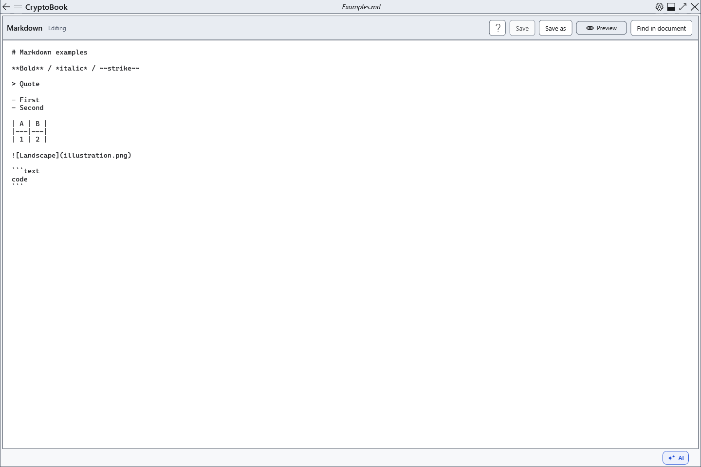

# Saving Markdown source

Saving writes source text including markup, rather than the visible preview. Select the Markdown editor first, especially when an ordinary document is also open.

## Steps

1. Click **Save** or Ctrl+S to write the current file.
2. **Save as** or Ctrl+Shift+S saves elsewhere. Cancelling the destination leaves the source open with its edits.
3. Reopen a copy and check text, markup and relative images. Images are not embedded in .md: transfer them separately while keeping relative paths.

## Check, undo and limitations

UTF-8/16/32 with a BOM are recognized on opening; without a BOM, UTF-8 is expected. Saving retains the detected encoding, BOM and source line endings. New Markdown uses UTF-8 without a BOM; there is no arbitrary encoding selector. Protected Markdown also saves source; protection conditions are covered separately. Exporting an ordinary formatted document back into Markdown is unsupported. If writing fails, save elsewhere and keep the unsaved source open.

## Related topics

- [Save and Save as](help:doc.save)
- [Formats and encodings](help:doc.formats)
- [Protected format compatibility](help:security.compatibility)
