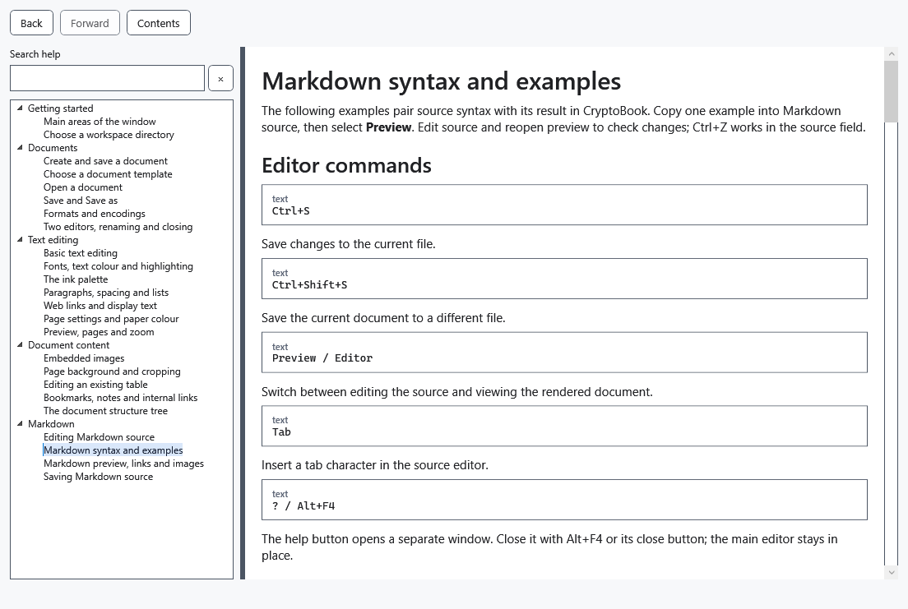

# Markdown syntax and examples

The following examples pair source syntax with its result in CryptoBook. Copy one example into Markdown source, then select **Preview**. Edit source and reopen preview to check changes; Ctrl+Z works in the source field.

## Editor commands

````text
Ctrl+S
````

Save changes to the current file.

````text
Ctrl+Shift+S
````

Save the current document to a different file.

````text
Preview / Editor
````

Switch between editing the source and viewing the rendered document.

````text
Tab
````

Insert a tab character in the source editor.

````text
? / Alt+F4
````

The help button opens a separate window. Close it with Alt+F4 or its close button; the main editor stays in place.

## Headings and separators

````text
# H1
## H2
…
###### H6
````

ATX headings of levels 1–6. An optional matching run of # characters may close the heading.

````text
Heading 1
=========
````

A level-one Setext heading.

````text
Heading 2
---------
````

A level-two Setext heading.

````text
---
***
___
````

A horizontal separator made from at least three -, *, or _ characters.

## Lists and quotes

````text
> quote
>> nested
````

A quoted block. Additional > characters create nested quotes.

````text
- item
+ item
* item
````

A bulleted list; -, +, and * are accepted as markers.

````text
1. item
2) item
````

A numbered list using . or ) after the number. The first number sets the starting value.

````text
- parent
    - child
````

Indent an item to create a nested list. Lists may contain paragraphs, quotes, code, and other lists.

## Inline formatting

````text
*italic*
_italic_
````

Italic text.

````text
**bold**
__bold__
````

Bold text.

````text
***bold italic***
````

Bold italic text. Three underscores may be used instead of asterisks.

````text
~~strike~~
````

Strikethrough text.

````text
`code`
``code with ` inside``
````

A monospaced code fragment. Use a longer backtick delimiter when the fragment contains a backtick.

````text
\*literal asterisks\*
````

A backslash displays Markdown punctuation literally instead of interpreting it as markup.

````text
&copy;
&#169;
````

A named or numeric HTML entity, converted to its Unicode character.

## Paragraphs and line breaks

````text
text

text
````

A blank line starts a new paragraph.

````text
text
text
````

A normal source line ending is displayed as a space within the same paragraph.

````text
text  ⏎
text
````

Two spaces at the end of a line insert a line break without starting a new paragraph.

````text
text\
text
````

A backslash at the end of a line also inserts a hard line break.

## Links and images

````text
[text](https://example.com)
````

A clickable HTTP, HTTPS, or email link.

````text
[text][ref]

[ref]: https://example.com
````

A link whose URL is declared elsewhere. Collapsed [text][] and shortcut [ref] forms are also supported.

````text
<https://example.com>
````

A web address displayed as a clickable link without a custom caption.

````text
<name@example.com>
````

An email address converted to a clickable mailto link.

````text
https://example.com
````

A bare HTTP or HTTPS address is recognized automatically.

````text

````

An image stored next to the Markdown file or in a relative subfolder.

````text
![alt][image]

[image]: images/picture.png
````

A local image whose relative path is declared in a reference definition.

## Code blocks

````text
```csharp
code
```
````

A fenced code block. Text after the opening fence is shown as a language label; syntax highlighting is not applied.

````text
~~~text
code
~~~
````

A fenced code block using three or more tildes instead of backticks.

````text
    indented code
````

A code block created by indenting every line by four spaces or one tab.

## Tables

````text
| A | B |
|---|---|
| 1 | 2 |
````

A pipe table. The separator row creates the header; outer pipes are optional.

````text
+---+---+
| A | B |
+===+===+
| 1 | 2 |
+---+---+
````

A grid table. = marks the header boundary; grid tables may span rows and columns.

## Preview limitations

````text
<b>HTML</b>
````

Raw HTML is shown as inert source text and is never executed.

````text
[file](file:///…)
[ftp](ftp://…)
[relative](relative.md)
````

FTP, file, relative, javascript, and other non-HTTP schemes are displayed as text, not active links.

````text

````

Remote and absolute-path images are not loaded; their alternative text is shown instead.

````text
- [x] task
[^1] footnote
$math$
````

All specially rendered syntax is listed above. Other Markdig extensions—including task checkboxes, footnotes, formulas, diagrams, definition lists, alerts, custom containers, media, abbreviations, inserted/marked text, subscript, and superscript—have no corresponding presentation.




## Check, undo and limitations

H1…H6 denote heading levels: replace the line containing an ellipsis with the required number of # characters. The word code stands for block contents, not an executable command. Spaces and blank lines matter: use two trailing spaces or a backslash for a hard line break. If formatting is missing, compare punctuation and indentation with the example. Preview executes neither code nor HTML. Save as .md to retain the markup itself.

In the line-break example, ⏎ marks the end of the line: do not type that symbol; keep two spaces before the newline.

## Related topics

- [Markdown preview, links and images](help:md.preview)
- [Editing an existing table](help:content.tables)
