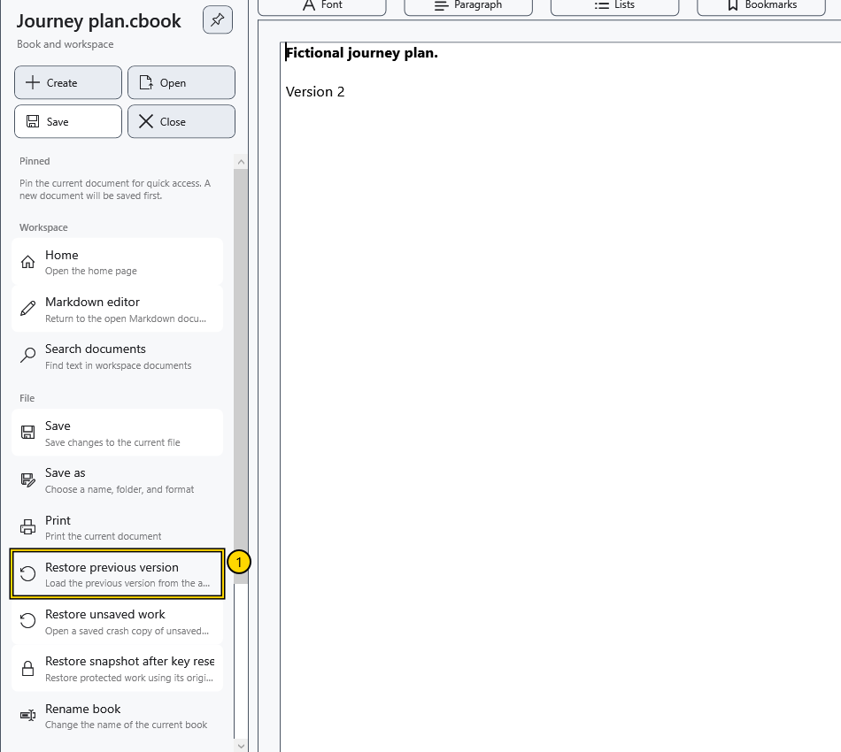
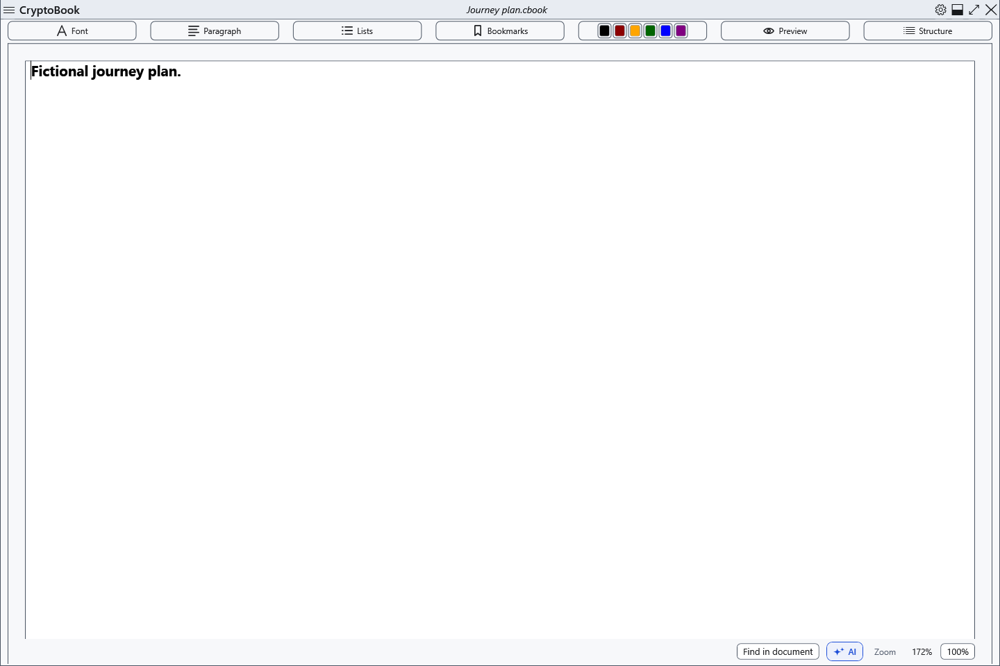

# Restore the previous .bak version

Successfully replacing an existing local document keeps its previous version beside it with .bak appended. This is one previous version, not a history of every edit. Saving a new file for the first time need not create .bak.

## Steps

1. Open the original document. Save any current work you need separately before recovery: loading the previous version replaces editor contents.
2. Open the side menu → **Restore previous version**. The command needs an existing .bak beside the current document.

3. Check the path in the confirmation and accept. A protected backup needs its matching key. Declining leaves the current editor unchanged.
4. Inspect the recovered document. It is marked modified; the current disk file has not been replaced. Explicitly save it, or choose **Save as** to retain both versions.

## Limits and returning

The next save refreshes .bak. An ordinary backup can contain readable data; a protected document's .bak needs its key. Changing keys synchronizes an incompatible backup with the current protected file, so an older text version is not guaranteed. Renaming through the application moves the associated .bak.

If unavailable, check that the intended document is open and has its .bak beside it. This mechanism is separate from crash and lock snapshots. To decline after inspection, close without saving the recovered changes and reopen the original; save any current work you need separately beforehand.

- [Saving](help:doc.save)
- [Crash snapshot](help:recovery.crash)
- [Lock snapshot](help:recovery.lock)
