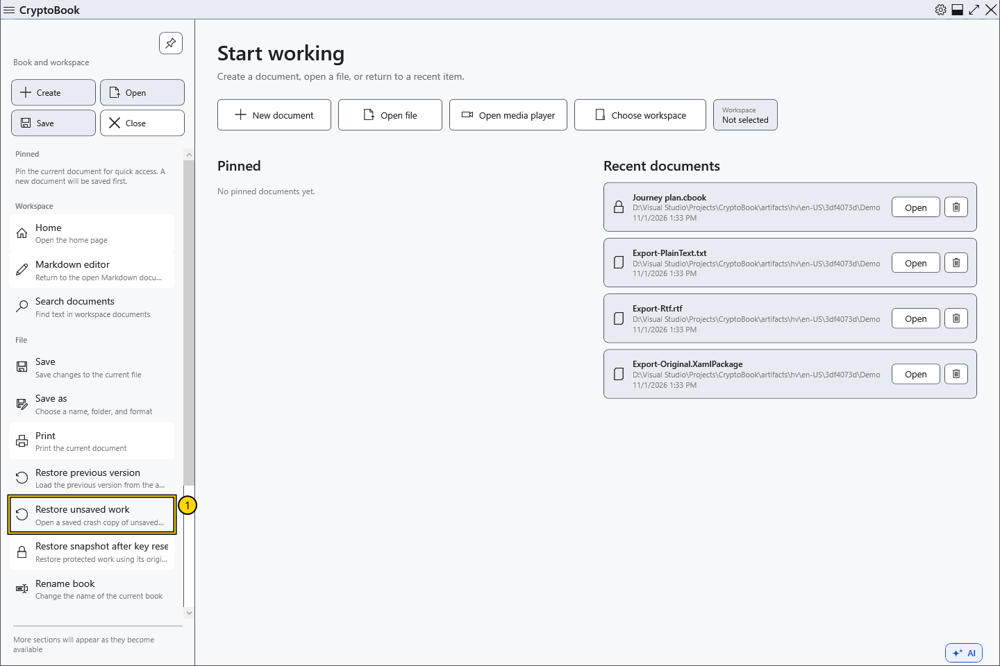
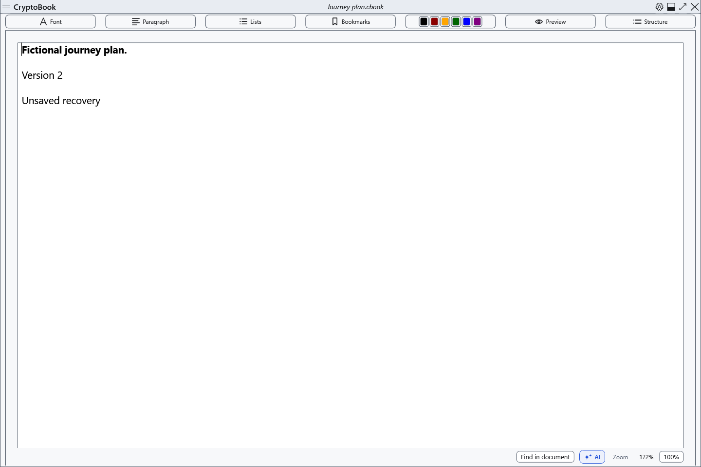

# Crash snapshot of unsaved work

CryptoBook periodically saves a separate snapshot of a modified workspace. It can help after unexpected termination, but does not replace saving: your latest actions may not yet be included. The usual delay after changes is about 15 seconds.

## Restore a saved copy

1. Retained crash copies are stored separately from new work. The application starts without recovery notifications.
2. Open the side menu → **File** → **Restore unsaved work**. Without a retained copy, the command is unavailable. With several copies, the latest by saved time is restored; older ones remain for subsequent recovery.
3. If current documents have changes, choose save, discard those changes, or cancel first. A protected snapshot requires the CryptoBook key used when it was created, not your Windows password.

4. Inspect the restored contents and save explicitly. They open as modified; check both documents if two were retained. Before consuming the selected deferred copy, CryptoBook writes a fresh crash copy of the recovered workspace.

## Cancellation and problems

You can continue working without opening recovery. Cancelling key entry or the decision about current work preserves the copy. For a wrong password or access failure, check the original key and retry; keep the recovery files.

Older crash copies can use the earlier Windows-account protection, including for work that was protected. A new password does not change existing copies; the CryptoBook-key requirement applies to the new protected-snapshot format.

Snapshots live in user data, separate from .bak and Lock. Ordinary snapshots use the current Windows account's protection; protected documents use the CryptoBook password. Moving an ordinary snapshot to another Windows account does not guarantee it can be read. A normal close deletes the current crash snapshot; previously deferred copies remain. This is not a backup on another drive.

- [Lock snapshot](help:recovery.lock)
- [Write errors](help:recovery.write)
- [Two editors](help:doc.switch)
