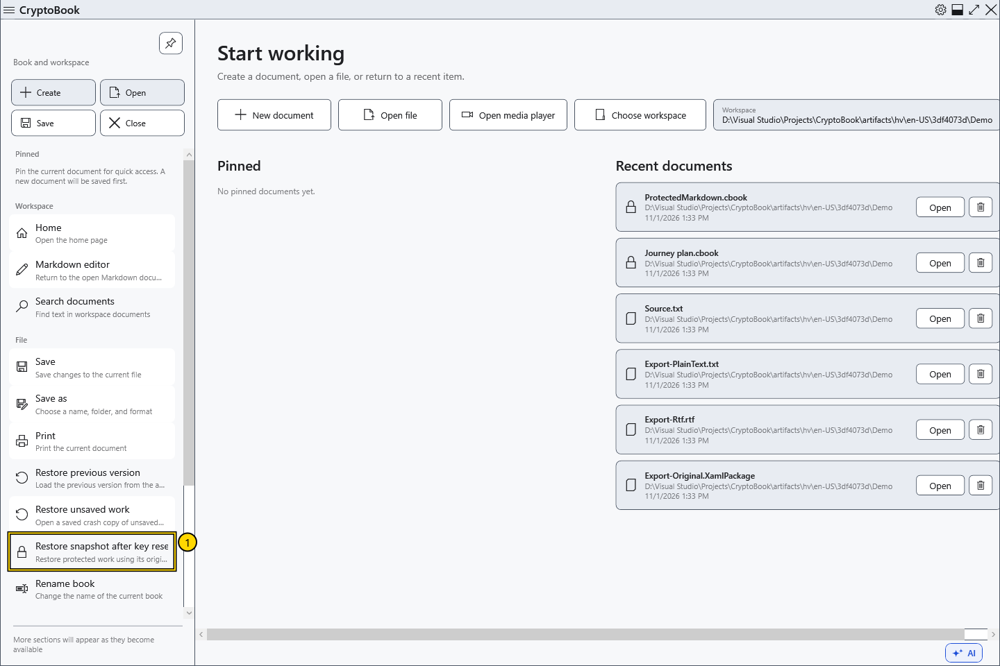
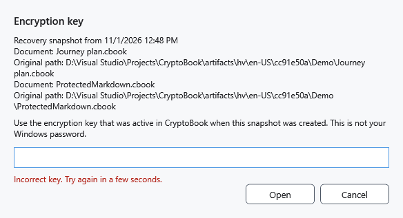
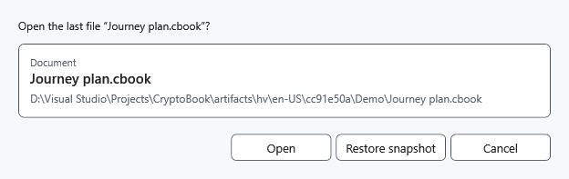

# Restore a snapshot after key reset

A lock snapshot retains protected work when the key is reset. It is separate from .bak and the crash copy, does not overwrite an ordinary source file, and requires the original CryptoBook key.

## Steps

1. Open the side menu → **File** → **Restore snapshot after key reset**. No recovery notices appear at startup or after a successful reset. Without a snapshot, the command is unavailable. For work hidden in memory after a snapshot failure, use **Unlock** and keep the application running.

2. Check the document description and enter the key used when creating the snapshot. There is one hidden field, with no repeat. **Open** verifies the key before access. A wrong key keeps the snapshot; wait a few seconds before retrying.

3. After verification, choose **Open** for the saved original file, or **Restore snapshot** for the snapshot's unsaved content. When the source is unavailable, snapshot recovery remains. Check both protected documents if present. Opening the source takes its saved version, not the active document's latest edits.

## Result and cancellation

Successful recovery deletes the snapshot. Snapshot content is marked modified and must be saved explicitly. Cancelling entry or the recovery choice keeps the snapshot. Cancelling the choice after key verification leaves the key cached; reset it again if needed.

If snapshot writing failed earlier, hidden in-memory work can be recovered only while that process is still running, using its original key. There is no universal bypass for a forgotten password.

- [Key reset](help:security.lock)
- [Crash snapshot](help:recovery.crash)
- [Previous version](help:recovery.backup)
