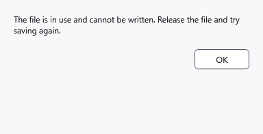

# Write errors and continuing safely

An error means saving did not finish. While the document is marked modified, keep the application running and retain original files and recovery copies.

## Steps

1. Read the message. If a file is busy, close the application holding it and retry **Save**. For denied access, choose a writable folder with **Save as**. For insufficient space, free space or choose another drive.
2. Keep the protected format and matching key for protected work. Cancelling a destination dialog or warning leaves current work unsaved. An ordinary output format may expose its contents.

3. After success, check that the modified marker disappears and the expected path is active. If unsure, reopen a saved copy and compare text and formatting.

## What remains

Local saving prepares the result before replacing the destination. In the checked busy-file failure, original bytes remain intact and text stays in the editor. This is not a guarantee for drive failure, power loss or every device operation. .bak holds a previous successful version; a crash snapshot holds unsaved work; a lock snapshot holds protected work at key reset. None means the original document was saved successfully.

Progress cancellation requests a stop: wait for completion and inspect output. A batch can finish partially; disk writing and encryption have no universal Undo. If a lock snapshot failed, unlock hidden work with the original key before closing its process. For MTP, also check connection, permissions and the actual device result.

- [Saving](help:doc.save)
- [Previous version](help:recovery.backup)
- [Crash snapshot](help:recovery.crash)
- [Lock snapshot](help:recovery.lock)
