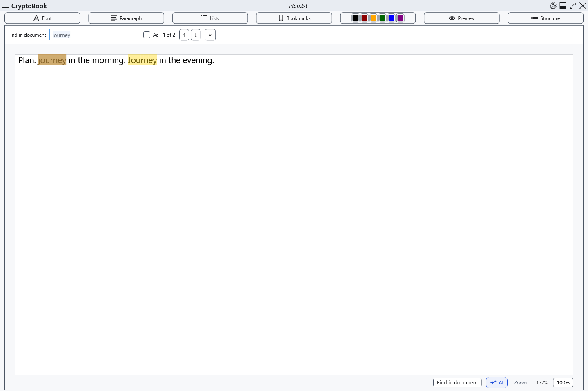
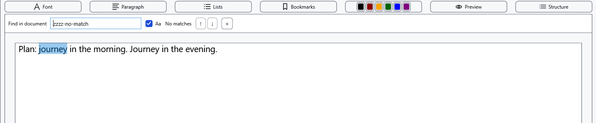
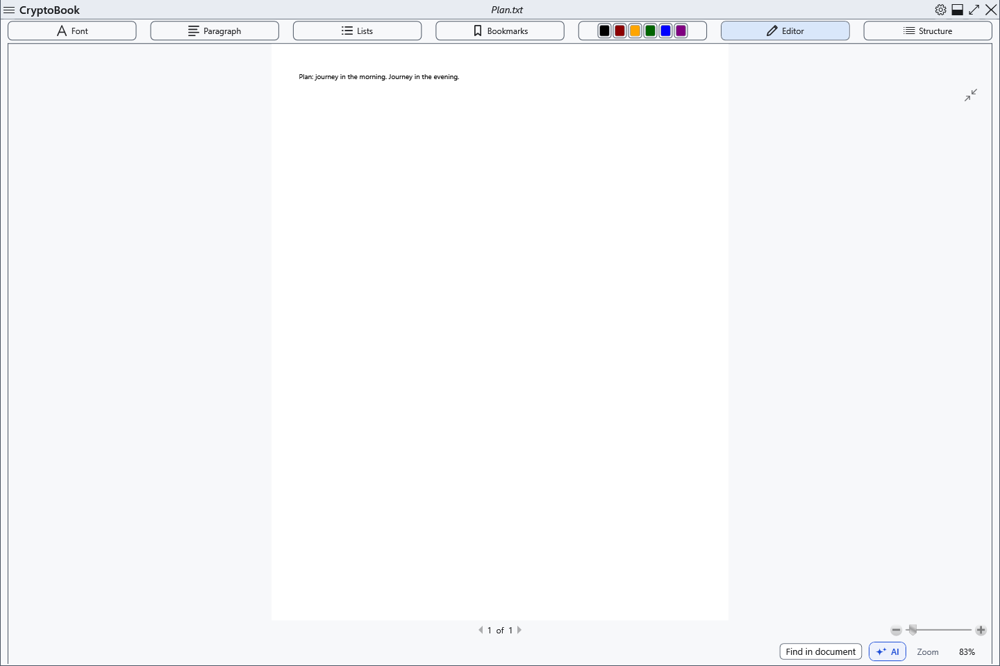
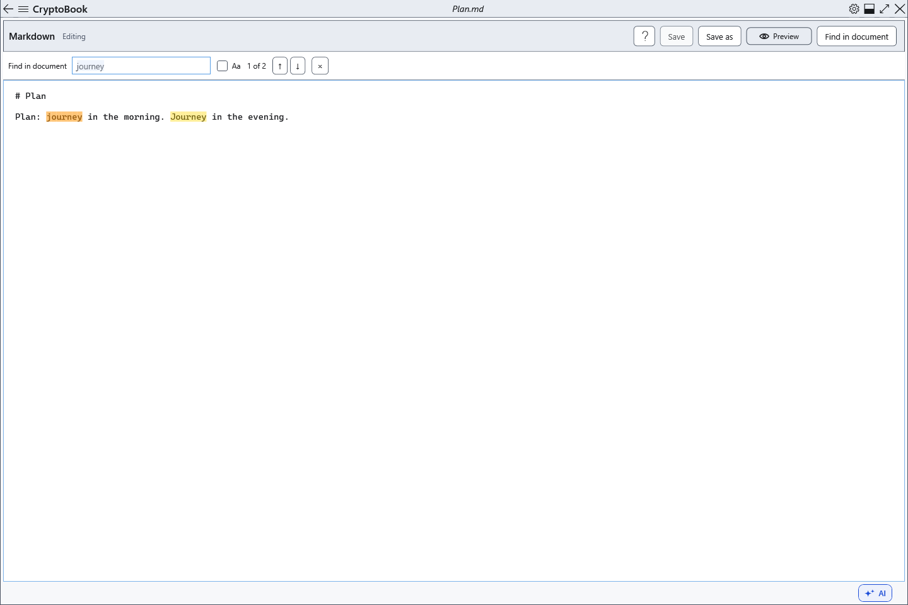
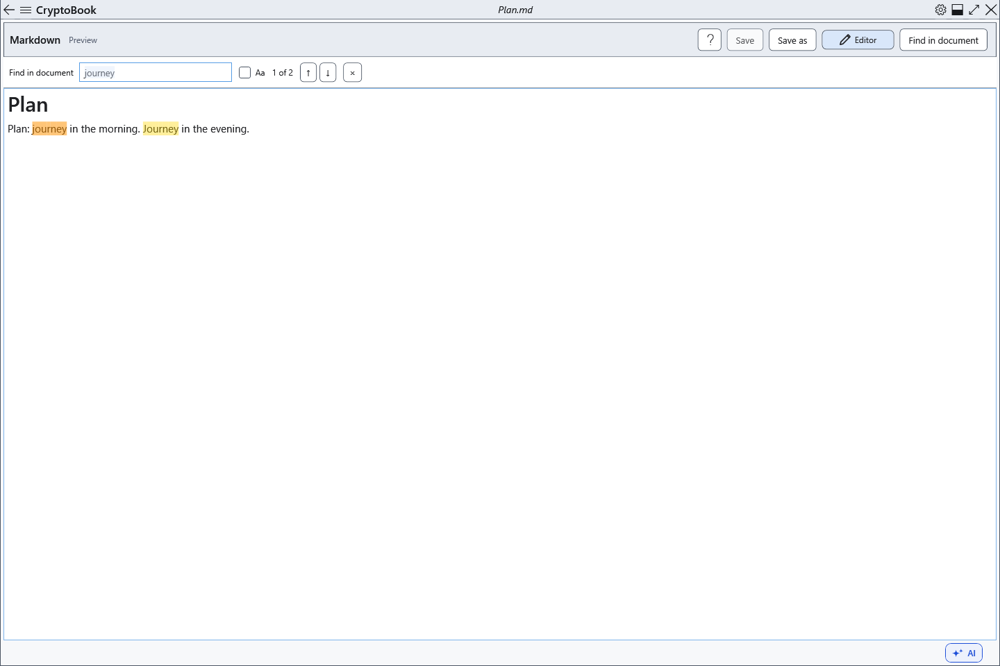

# Find text in the current document

Search highlights matches in the current document and shows the result number.

## Before you start

Open the desired document and activate its page. Markdown source contains markup while preview contains rendered text, so their matches can differ.

In an ordinary document, switching to paged preview closes search. Find or Ctrl+F from that preview returns to editing and searches there. Both Markdown modes support search.

## Steps

1. Choose **Find in document** or press Ctrl+F with focus in the document area. Enter text; highlights and a counter appear after a short delay.
2. Enable **Aa** (**Match case**) for case-sensitive matching.
3. The ↑/↓ buttons select the previous/next match. Enter and Shift+Enter work in the query field; F3 and Shift+F3 work in the document area while the panel is open. Navigation wraps at the end.
4. Choose × (**Close search (Esc)**) or press Esc in the document area to close the panel.

## Check the result

The current match is selected and scrolled into view. Matching is literal, with no replacement, wildcard syntax or image text recognition. Results refresh as the document changes.

## Cancel and return

Closing removes search highlighting and returns focus to the editor. It does not change text or undo edits.

## If it did not work

For no matches, check Aa and the Markdown mode. Enter outside the query field is not a search command. Ctrl+F in Help searches Help; its meaning in other windows depends on focus.

## Related topics

- [Preview, pages and zoom](help:edit.view)
- [Editing Markdown source](help:md.edit)
