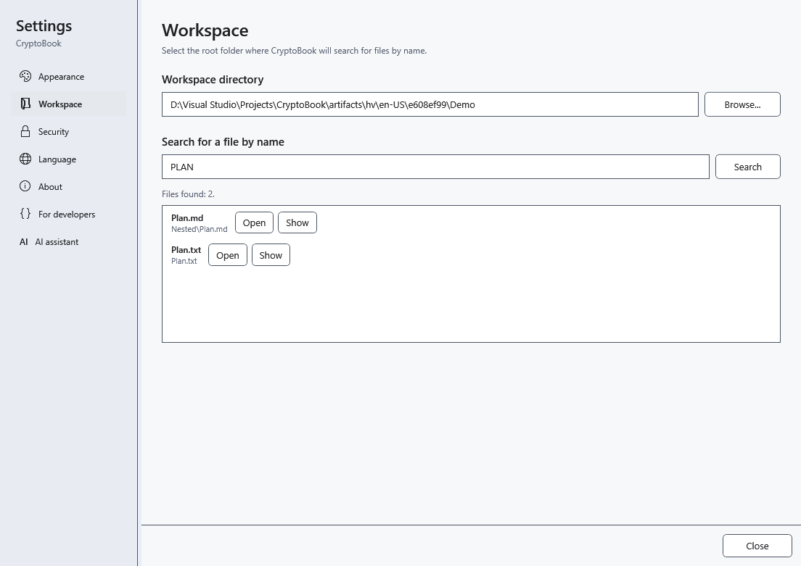

# Find files by name

Name search finds files in the selected workspace folder and its subfolders. It has a different scope from the current-folder filter in the file manager and from document content search.

## Before you start

Select a local workspace folder first. A connected Android device is outside this search scope.

## Steps

1. Open settings and select **Workspace**. Check the workspace path.
2. Under **Search for a file by name**, enter part of a name, including the extension if useful. Case does not matter; wildcards and regular expressions are treated as literal text.
3. Choose **Search** or press Enter in that field. Check each result’s relative folder.
4. Choose **Open** beside the desired file. Use the button with the **Show file in File Explorer** tooltip to show its location.

## Check the result

The selected file opens. Settings closes when a document opens internally; external formats depend on a Windows application. The list contains up to 200 files.

## Cancel and return

Change the query and search again, or close settings. This name-search panel has no separate cancel button. Searching does not change files.

## If it did not work

No results: check the workspace path and shorten the name fragment. A truncated list or skipped folders means you should narrow the query and check access to subfolders. This search does not examine file contents.

## Related topics

- [Choose a workspace directory](help:start.workspace)
- [Search document contents](help:search.workspace)
