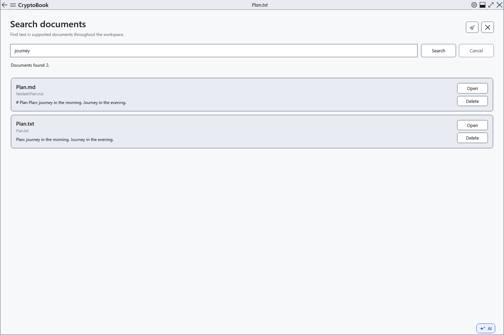
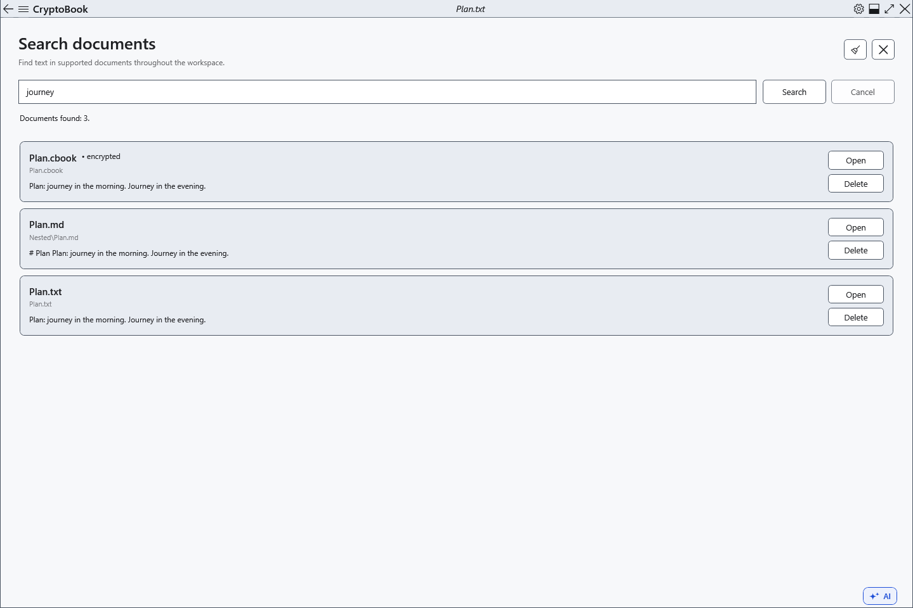

# Search document contents

Content search lists files containing the requested text and a snippet around the first match. It searches the local workspace and accessible subfolders. Unsaved editor changes are outside a search of files.

## Before you start

> **Delete** on a result deletes the file after confirmation. This route currently deletes directly through the provider; Windows Recycle Bin restoration is unavailable. Use the file manager when you need recycling.

Supported formats are TXT, LOG, MD, CS, XAML, JSON, XML, RTF and XamlPackage. PDF and image text recognition are unsupported. The usual file limit is 16 MiB and the result limit is 200 files.

## Steps

1. In the side menu, open **Workspace → Search documents**.
2. Enter literal text or a phrase and choose **Search**. Matching ignores case; a phrase is searched as one string. Choose **Cancel** to stop.
3. Check the name, relative folder and snippet. **Open** opens the file without jumping to a match; use document search afterwards.
4. **Clear** removes the query and results; **Close** returns to the active editor.

## Check the result

Each matching file has one result card. Protected files have a separate label. When protected files exist, a key is requested; cancelling skips them. Protected content is searched in memory and is not saved in the search index.

Markdown is searched as saved source, including its markup.

## Cancel and return

Cancel stops the current search. Clearing results does not delete files. Closing the page also stops searching.

## If it did not work

Save editor changes first. Check status messages for skipped, large, unsupported or inaccessible files. Protected documents need a suitable key; searching them without one is not supported.

## Related topics

- [Find text in the current document](help:search.document)
- [Key and password](help:security.password)
- [Two editors, renaming and closing](help:doc.switch)
