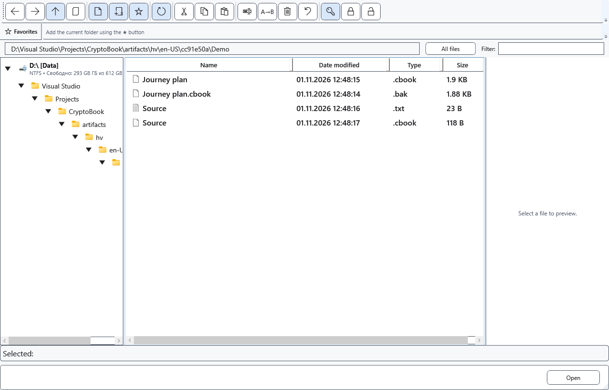

# Protected file compatibility

A filename or extension does not prove a file is encrypted. CryptoBook identifies a container by its contents. In-place encryption can retain the old extension; verified separate copies use .cbook. .cbox is also recognized as a protected container.

## Open and transfer

1. Open the file in CryptoBook with its original key. New files use the current format; the older format remains readable. Renaming an extension neither converts the contents nor removes the password.
2. Compare text and formatting. A protected editor document may contain XamlPackage, rather than plain text. Protected images, videos and other binary files do not become editable text.
3. For another application, explicitly decrypt to the appropriate original format or RTF. Choose TXT only if losing formatting and non-text elements is acceptable.

## Keys and problems

An old short password may be accepted for reading. New encryption needs a password meeting the current rules. After changing the key when saving, also check .bak: a backup incompatible with the new key is replaced by the current protected file and may no longer contain an earlier version.

For a wrong key, damaged file or unsupported contents, keep the only original unchanged and try a separate saved copy. Your Windows password does not replace the CryptoBook key. There is no universal recovery for a forgotten password. Cancelling opening leaves the disk file intact.

- [Document formats](help:doc.formats)
- [Decryption](help:security.decrypt)
- [Previous-version backup](help:recovery.backup)
