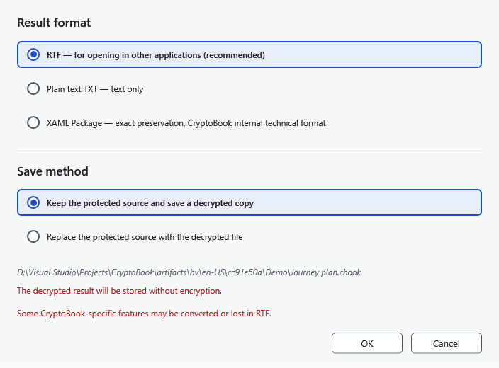
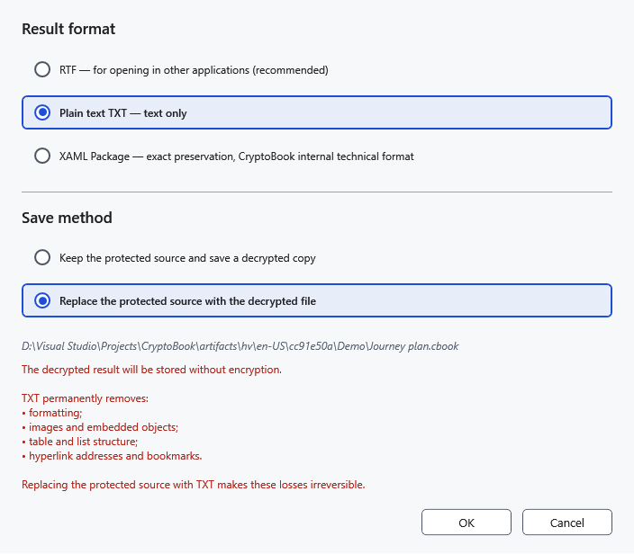

# Decrypt files and folders

The decrypted result is readable without a key. Before replacing a protected source, make sure you intend to leave readable data and have chosen the right format.

## Steps

1. Select the protected file in the file manager and choose **Decrypt selected items**. Use its original encryption key.
2. For a single .cbook/.cbox, choose the output format. **RTF — for opening in other applications (recommended)** suits other editors. TXT keeps text only, losing images, tables and formatting. The original-format option retains original contents. Available formats depend on the contents, not merely the container name.
3. Choose **Keep the protected source and save a decrypted copy** or **Replace the protected source with the decrypted file**. A copy needs a destination; replacement removes the protected source after successfully saving the output and requires separate confirmation.

TXT replacement adds a warning about lost formatting. Do not accept it if you need images or tables. Keep a protected original for returning to it.

## Folders, batches and results

Folders and multiple items have a separate copy/replacement choice. Folder processing is recursive; unprotected files are skipped during decryption. Copy mode preserves existing destinations and gives conflicting copies unique names. Reopen output in an appropriate editor to check text and formatting.

A readable Android file can be decrypted; replacement additionally requires write and delete permission. This does not imply support for encrypting a whole remote folder.

## Cancel and retry

**Cancel** in options cancels decryption before writing. Cancellation in progress requires waiting for the operation to stop; finished items can remain. For a wrong key, enter the original password again. On write failure, check access and free space, keeping the container until you verify the output.

- [Protection](help:security.protect)
- [Device limits](help:devices.limits)
- [Formats](help:doc.formats)
