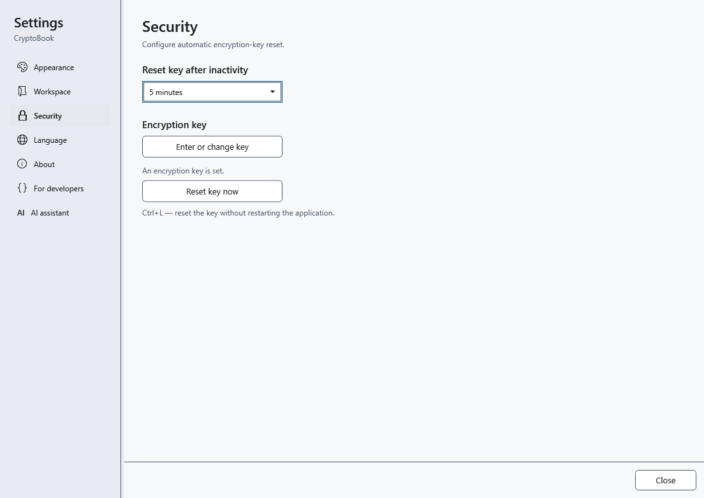
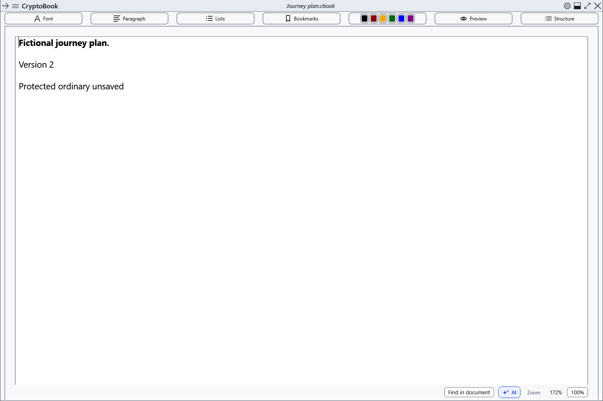

# Reset the key and lock protected work

Ctrl+L clears the encryption key from application memory. When only ordinary documents are open, they remain open with their unsaved changes. Having a cached key does not make those documents protected.

## Settings and manual reset

1. Open settings → **Security**.
2. Under **Reset key after inactivity**, choose 1, 5, 10, 15 or 30 minutes, or **Never**. It takes effect immediately; the default is 15 minutes. Activity inside CryptoBook restarts the countdown, and long file operations pause it.
3. Press Ctrl+L in the main window/settings, or choose **Reset key now**, to reset immediately. Without a key there is nothing to reset. Losing window focus alone does not reset it; locking the Windows session or entering sleep triggers a secure reset.

## Protected workspace behaviour

CryptoBook saves and verifies a protected snapshot, then clears the key and protected editors. When both independent documents are protected, both are included. With only one protected document, its ordinary neighbour is retained separately in the workspace. Content windows are hidden/closed and AI activity stops.

After success, ordinary work remains available. Snapshot recovery is available on request through the side menu. If creating the snapshot fails, the key is still cleared and unsaved protected work stays hidden in memory behind a lock screen. **Keep the application running:** unlock with the original password and save your work.

## Return

Open the side menu → **File** → **Restore snapshot after key reset**. For work hidden in memory after a snapshot failure, use **Unlock**. Cancelling entry keeps the snapshot. **Never** disables the inactivity timer; manual reset and system events remain.

- [Lock snapshot recovery choices](help:recovery.lock)
- [Key entry](help:security.password)
- [AI lifecycle](help:ai.lifecycle)
