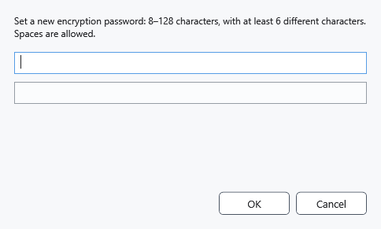
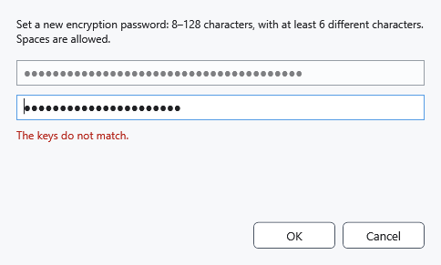

# Encryption key and password

The key opens protected files. Entering another key does not change the password of files already saved. Keep your password safely: CryptoBook cannot reset a forgotten password using your Windows password.

## Steps

1. Open settings → **Security** → **Enter or change key**, or **Set encryption key** in the file manager. Opening a protected file requests a key automatically when none is available.
2. For new encryption, use 8–128 characters with at least six distinct characters, ignoring case. Spaces are allowed. Digits alone, repeating sequences and common weak combinations are rejected. Choose a long, unique password.
3. Enter it in the upper field and press Enter to enable the lower field. Repeat it, then select **OK** or press Enter. Characters stay hidden; this dialog has no password-reveal button.

Correct both fields if they differ. Reading an older file accepts its original password even when it does not meet the rules for new encryption; saving again may request a stronger password.

## Result, cancellation and problems

Settings shows **An encryption key is set.**. This confirms a key in memory, not that it matches every file. Opening a specific file verifies that match. **Cancel** closes entry. If opening fails, check the original password and a separate intact copy; keep the only original unchanged. Ctrl+L clears the cached key.

- [Protect documents](help:security.protect)
- [Reset the key](help:security.lock)
- [Restore a lock snapshot](help:recovery.lock)
