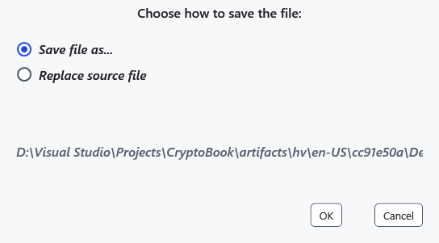
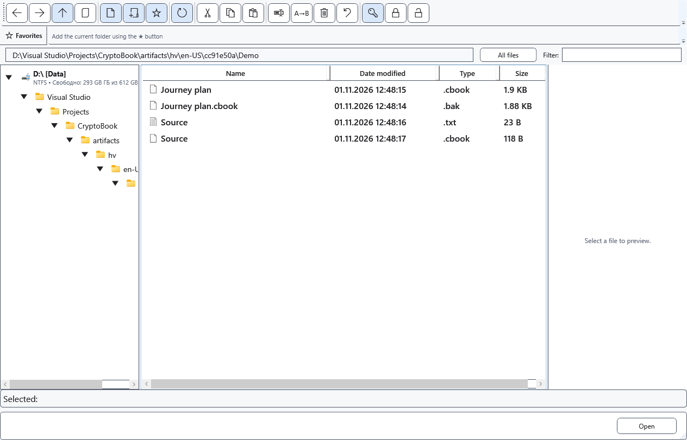

# Protect documents and files

A protected copy lets you check encryption while keeping the source. That source remains readable without a key. Before replacement, make sure you know the password and have a separate copy you need: completed encryption has no universal Undo.

## Editor document

Choose **Save as**, the protected .cbook format and a destination. Read and accept the warning, entering a new key when requested. Saving an ordinary file with a cached key may offer a protected copy. Check the active document path afterwards; the ordinary source is not automatically deleted.

## Files and folders

1. Select files in the file manager and choose **Create protected copies (.cbook)**. One file gets a copy beside it; for several files choose a destination folder. Output is verified, existing files are preserved and conflicting names get unique names. Already protected files are skipped. This command does not process folders.
2. Choose **Encrypt or replace selected items…** for another mode. A single file offers **Save file as...** and **Replace source file**. Replacement requires confirmation.

3. Encrypting a folder through this command processes it recursively in place after a warning. A selection of several items also replaces sources. The source-preservation promise of protected copies does not apply here. Whole-drive encryption is unavailable; device capabilities must be checked separately.

## Check and cancel

Open the result with the correct key and compare its contents. In-place encryption can keep the old extension; inspect contents and successful opening. Select **Cancel** before confirming, or request cancellation in progress and wait for completion. Completed batch items can remain changed. After a failure, inspect each result and check access and space, preserving sources.

- [Decrypt](help:security.decrypt)
- [Compatibility](help:security.compatibility)
- [Write errors](help:recovery.write)
