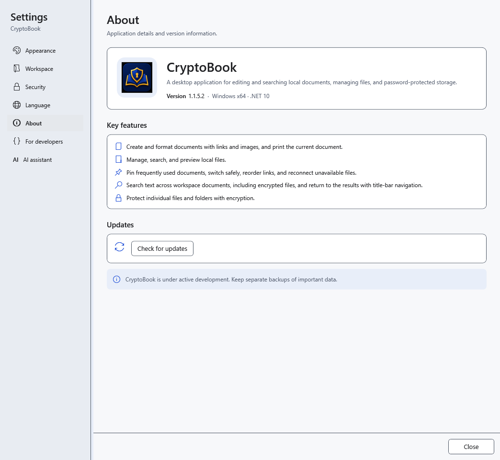
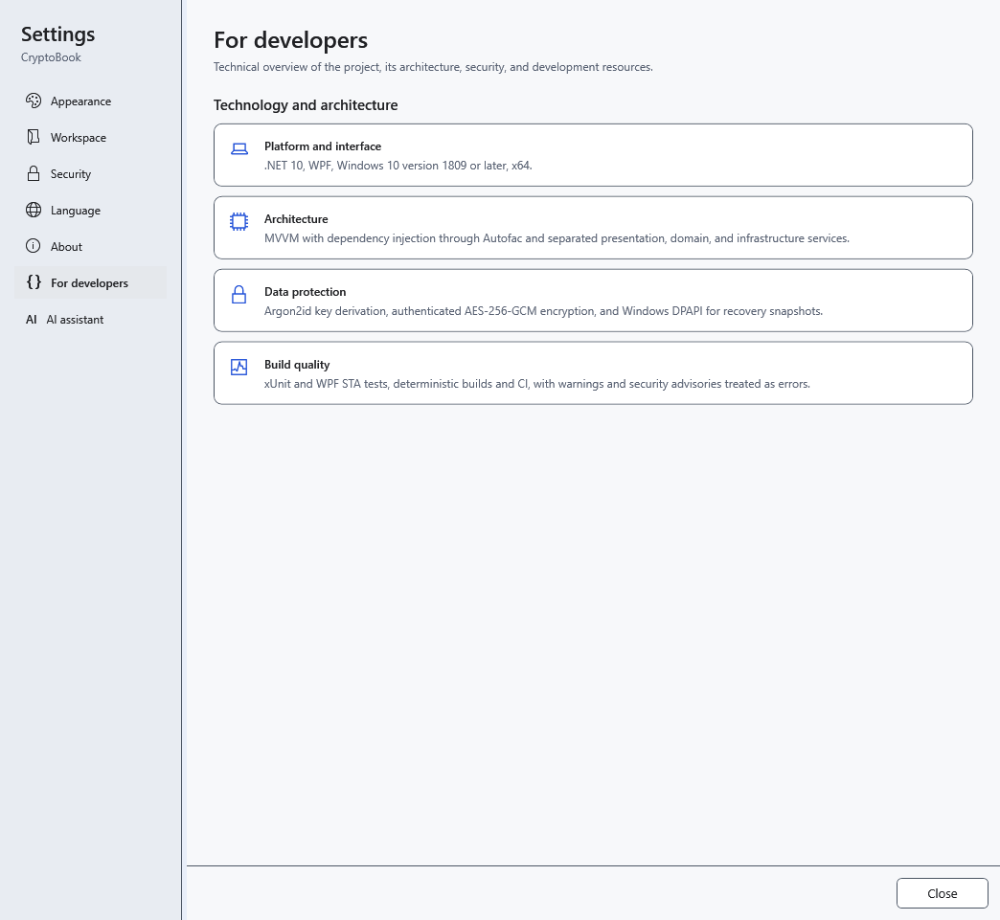

# Version and application information

Before reporting a problem, find the version of the **running** application. Launching an older portable folder may run a different version from the one you recently installed.

1. Open **Settings → About**.
2. Find **Version** beside the CryptoBook name. Include this value, the Windows version and your steps when describing a problem.

3. **For developers** describes the platform, architecture, protection and project checks.

This information does not check a particular file, computer or backup. There is no password-recovery tool here. The new-version check is under **About**, in **Updates**. Close settings to return to work; reading the information does not change your document.

- [Application updates](help:settings.updates)
- [Common problems](help:settings.troubleshoot)
- [Installation and portable use](help:start.install)
