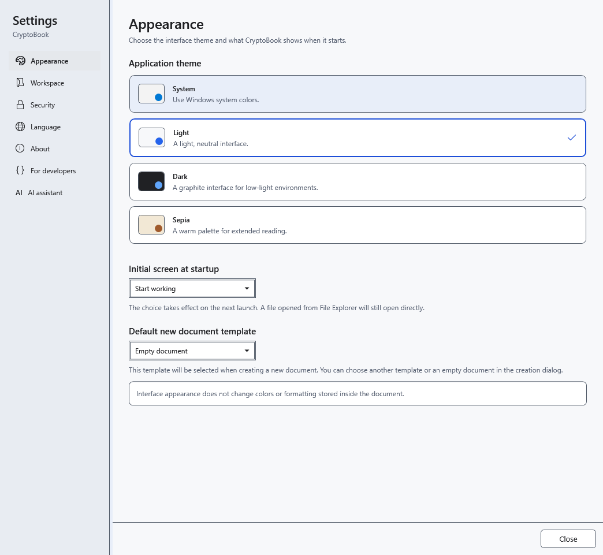
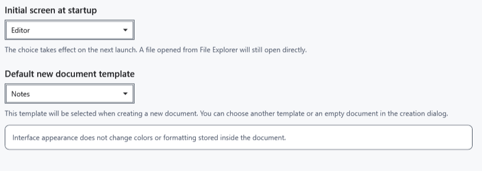

# Theme, startup screen and default template

Open **Settings → Appearance**. These choices control the application and defaults for new work. An open document retains its own formatting.

## Change preferences

1. Select **Light**, **Dark**, **System** or **Sepia**. The theme applies and saves immediately. The system choice follows Windows light or dark mode.

2. Under **Initial screen at startup**, select the start screen or editor. This applies on the next launch; opening a specific file from Explorer takes priority. The current document stays open and the current screen does not change immediately.
3. Under **Default new document template**, choose a template. It is suggested next time you create a document; the creation dialog still lets you choose another template or an empty document.

## Check and revert

Close and reopen settings to check the selection. There is no separate Apply button here; closing does not undo changes. Select the previous theme, screen or template to revert. Drag the divider on the left to resize settings navigation.

The theme does not recolor saved text, paper backgrounds or images. Change those in the editor; AI appearance has separate settings. A startup choice that leaves the current screen unchanged is expected: save your work and check the next normal launch.

- [Document templates](help:doc.templates)
- [Text colors](help:edit.font)
- [Interface language](help:settings.language)
- [AI appearance](help:ai.appearance)
