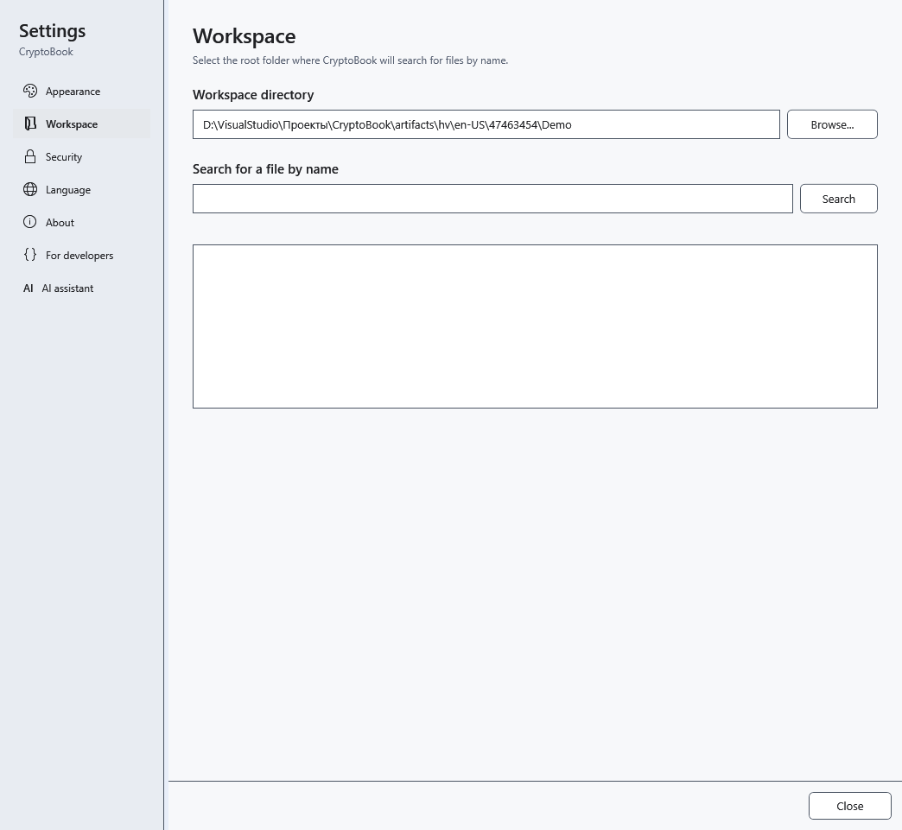

# Where data and preferences are stored

The workspace is your document folder, not the complete CryptoBook profile. Installed and portable versions use the current Windows user's data outside the exe folder.

## What to back up

| Data | Location and meaning |
| --- | --- |
| Documents, protected files, `.bak` | Folders you choose; a `.bak` beside the original is one previous version, not a full change archive |
| Theme, language, startup screen, template, window and help sizes | `user.config` in the local Windows profile; subfolders depend on the version and application launch path |
| Favorites, pinned and recent documents | `%LOCALAPPDATA%\CryptoBook\favorites.json`, `pinned-documents.json`, `recent-documents.json`; references and paths, not document copies |
| AI preferences, template instructions and performance profiles | `ai-settings.json`, `ai-runtime-profiles.json` in that folder; GGUF and mmproj remain in the folders you chose |
| Update checks and skipped version | `update-check.json` in that folder |
| Search index for ordinary documents | `Search\*.db` in that folder: can contain ordinary-file text; decrypted protected-document text is not written there |
| Recovery-save diagnostics | `Logs\recovery.log` in that folder; check it for personal paths before sharing a report |
| Crash recovery / key-reset snapshot | `Recovery` / `Lock` subfolders; distinct mechanisms that do not replace backups |

Enter `%LOCALAPPDATA%` in Windows Explorer's address bar. Do not edit service files while the application is running. AI chat is not saved between launches; transfer important answers to a document first. The encryption password cannot be recovered from preferences. Windows-protected snapshots depend on the Windows profile; copying the folder to another computer does not guarantee they can be read.

## Updates and moving data

Before updating, save and close the application and copy important documents separately. The application attempts to migrate compatible preferences from an earlier version; this does not transfer all data to another computer. After startup, check the language, theme, workspace, pinned-file and model paths. A missing reference does not mean the document was deleted: locate the original and repair its path.

Service JSON files can contain paths and instructions you entered. Do not publish the whole profile with a bug report. Close the application before taking a complete backup; do not delete `Recovery` or `Lock` before checking recovery. Temporary update downloads are under `%TEMP%\CryptoBook\Updates`, outside the workspace.

- [Updates](help:settings.updates)
- [Crash recovery](help:recovery.crash)
- [Key-reset snapshot](help:recovery.lock)
- [AI templates](help:ai.templates)
- [Pinned documents](help:files.pinned)
