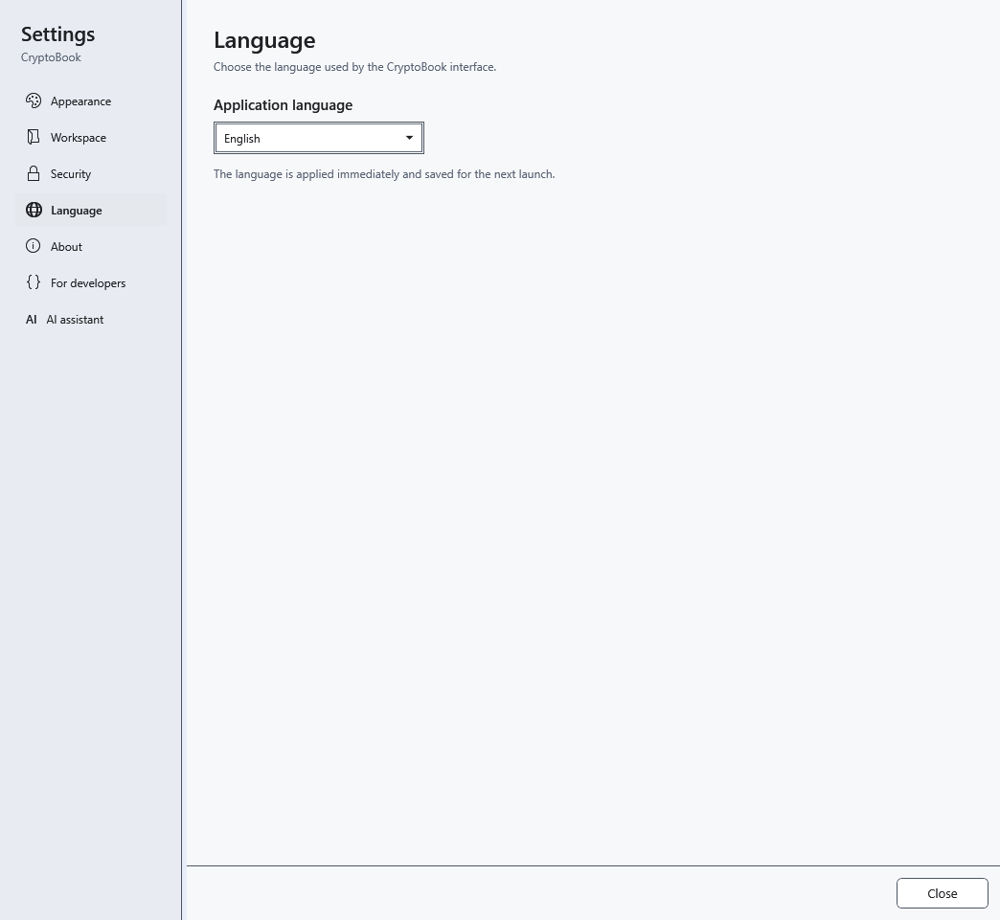

# Application and help language

CryptoBook supports English, Русский, Українська and Deutsch. The selection changes the interface and built-in help; your document text and AI responses are not translated automatically.

1. Open **Settings → Language**.
2. Choose **Application language**. The language applies immediately and saves for the next launch.

## What happens to open help

The same topic remains open in translation. The search query and results clear, and reading positions in the history return to the start. This prevents navigation through results in the previous language. Enter a new query in the selected language.

Closing settings does not undo the choice; select the previous language in the same list. If a word remains unchanged, check whether it is document content, a file or model name, or a proper name: such data is not translated. To request AI answers in another language, change the instruction in a conversation template.

- [Using help](help:help.use)
- [Application appearance](help:settings.appearance)
- [AI conversation templates](help:ai.templates)
