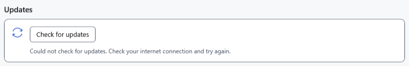

# Common problems and safe next steps

First save accessible work separately and record the exact message, application version and steps. Do not delete the original, `.bak`, `Recovery` or `Lock` to fix an unexplained error. Use a copy of an ordinary document for experiments.

| Symptom | Check and action |
| --- | --- |
| A button is unavailable | Check the active document, selection, read mode and running operation. Batch rename needs at least two eligible files. Return focus to the intended window |
| Saving fails | Check space, write permissions, folder availability and locks held by another application. Try saving to another accessible folder; keep the original |
| A document looks different | Check its extension: TXT does not retain formatting; Markdown stores source text. Check preview mode and the selected editor |
| A recent or pinned reference is unavailable | The drive may be disconnected or the file moved. Connect the source or repair the path; a list entry is not a file copy |
| A protected file will not open | Check the file and password. Wrong keys, damage and incompatible formats need different actions; changing an extension does not decrypt a file. Preferences cannot reveal the password |
| Work disappeared after key reset | Use the File menu's snapshot recovery action and the previous key; if the snapshot failed, keep the process open until hidden work is restored |
| Android is absent | Unlock it, enable USB file transfer/MTP and check the cable and connection. Do not blindly repeat a move: check both ends of the operation |
| PDF or video will not open | PDF requires an associated Windows application; video depends on the format and source availability. Changing the password does not fix a missing system handler |
| AI cannot send or load | Read the unavailable reason and model status; check GGUF, a suitable image projector, context and memory. Do not repeatedly restart without checking the cause |
| Help cannot find a word | Select the language, shorten the query or use article wording. Help search is separate from document and file search; Contents clears the query |

For an update error, check the network, GitHub, permissions and temporary-folder space. Do not manually run a file with a checksum or signature failure. If preferences appear reset after switching portable folders, check the running version and previous profile; keep old data until verified.

A useful report includes the version, steps, format and a sanitized example. Do not attach a password, key, whole profile, personal documents or chat.

- [Write errors](help:recovery.write)
- [Device limitations](help:devices.limits)
- [AI errors](help:ai.troubleshoot)
- [Updates](help:settings.updates)
- [User data](help:settings.data)
