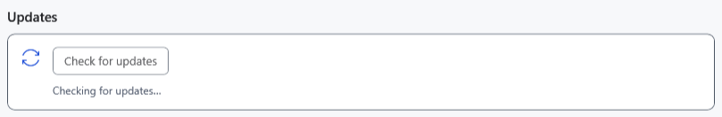
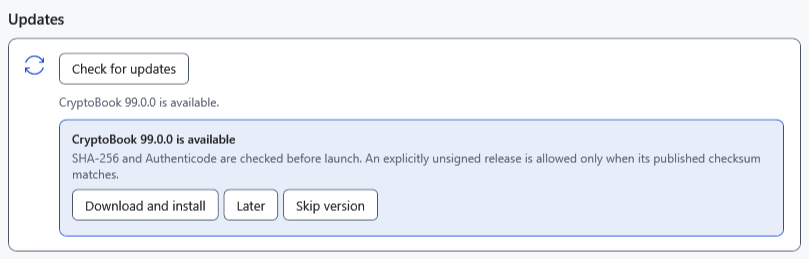

# Checking for and installing updates

A check finds newer stable versions; installation separately downloads and launches an installer. Before installing, save both ordinary and Markdown documents and make separate copies of important files. AI chat is not saved between launches.

## Check the version

1. Open **Settings → About** and find **Updates**; scroll down if needed.
2. Select **Check for updates** and wait while **Checking for updates…** is displayed.

With no newer version, **You have the latest version of CryptoBook.** appears. A background check runs at startup if at least 24 hours have passed since the previous check; it is not a continuous timer. A manual check bypasses this interval and a previously skipped version.

## Choose an action

- **Later** dismisses the current notification without recording a skipped version.
- **Skip version** records that version and suppresses it in background checks. It does not block a different newer version.
- **Download and install** downloads an installer. Release asset addresses, SHA-256 and Authenticode state are checked. An explicitly unsigned release is accepted with a matching checksum; invalid signatures or checksum mismatches are rejected. The installer then starts with elevation and the application exits. An older source without an installer asset may instead open the release page.

The built-in update uses an installer even from portable. To update with a ZIP, follow the installation instructions. Downloads use the Windows temporary folder; cancellation or failure stops the operation and removes the incomplete `.download`. Once the separate installer has started, cancellation belongs to its window. After successful installation, start CryptoBook and check the version, settings and documents.

## If checking or installing fails

For **Could not check for updates. Check your internet connection and try again.**, check internet/GitHub access and retry later. For a download error, check TEMP space and permissions. If integrity verification fails, do not run the downloaded file manually: download again from a trusted source. Refusing UAC does not install the update. Do not delete your profile or documents to fix an update error.

- [Installation and portable use](help:start.install)
- [User data](help:settings.data)
- [Saving documents](help:doc.save)
- [Common problems](help:settings.troubleshoot)
