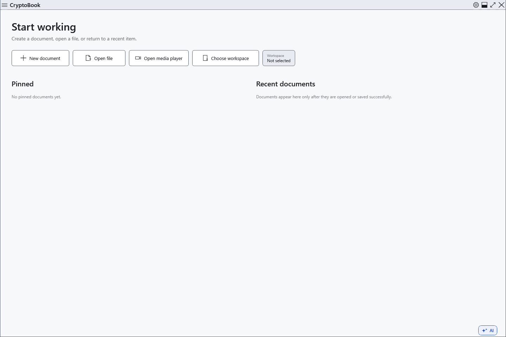

# Installation and portable startup

CryptoBook requires Windows 10 version 1809 or later, x64. Official packages include the .NET runtime; a separate Desktop Runtime installation is unnecessary. AI models are supplied separately.

## Choose how to run

1. For installation, obtain `CryptoBook-Setup-<version>.exe` from the project's releases. Before running it, compare its SHA-256 with the entry in that release's `SHA256SUMS.txt`; `SIGNING-STATUS.txt` declares its signing status.
2. Save documents and close CryptoBook. Run the installer, approve Windows elevation, choose the application folder and an optional shortcut. Keep personal documents outside the installation folder: updates replace and remove application files there.
3. For portable use, extract the **entire** `CryptoBook-win-x64.zip` into a separate folder and run `CryptoBook.exe`. Do not run inside the ZIP or copy only the exe without the rest of the package.

The installer registers CryptoBook in Windows Open with for `.cbook` and `.cbox`; you choose the default application. Portable does not register these automatically.

## First run and updates

Open **Settings** using the title-bar button. Choose a language, theme and workspace without creating an encrypted document. Encryption needs your own password; installation does not create one.

Portable uses the Windows user profile for settings, history and recovery, just like the installed version. The exe folder is not a complete portable copy of your data. The built-in update action runs an installer; to continue using ZIP packages, extract the new package into a new folder and launch it there after closing the old version.

If startup fails, check the Windows version, x64 support, complete extraction and free space in TEMP. Windows may warn about an unsigned file; check the source, checksum and signing declaration first. Do not disable Windows protection to run an unknown file. Use Windows to uninstall an installed copy; keep documents separately and back them up yourself.

- [Interface preferences](help:settings.appearance)
- [Updates](help:settings.updates)
- [User data](help:settings.data)
