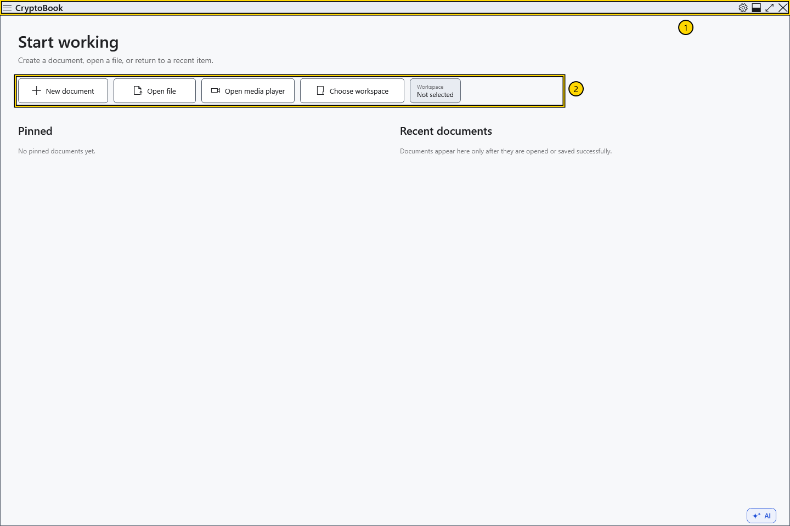
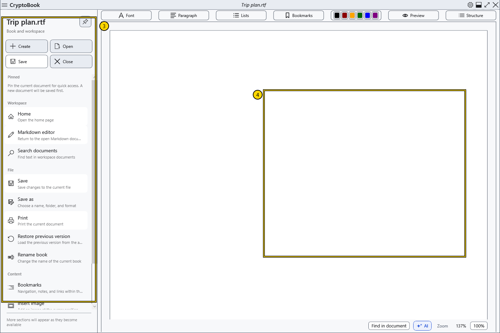
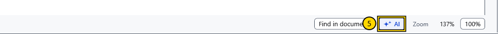

# Main areas of the window

Use the start screen to create or open a document. Once a document is open, the centre of the window becomes your reading and editing area.

## Find your way around

1. **Top bar.** On the left are the back and forward arrows and the menu button with three horizontal lines. These arrows move between application pages. The document name appears in the middle. The gear on the right opens **Settings**; the window controls are beside it.
2. **Start screen.** **New document** opens the creation dialog, **Open file** opens the file picker, and **Choose workspace** selects a folder for workspace searches. Pinned and recent documents appear here when the lists contain entries.

3. **Side menu.** Open it with the three-line button. The quick actions include **Create**, **Open**, **Save** and **Close**. Below them, **Workspace**, **File** and **Content** group the other commands. Open the menu again to find commands while following an instruction.
4. **Document area.** An ordinary document has formatting controls above its text. Markdown uses a separate editor. Moving between pages does not turn one document into the other; check which editor is active before saving.

5. **Below the ordinary editor.** Find document search, the **AI assistant** button and zoom controls here. The assistant panel opens on the right when available. Its use requires separate setup.

## Try it

Open and close the side menu, then open **Settings** with the gear. Close the settings window to return to your document. If you still see the start screen, create a demonstration document to see the editor controls.

## First steps and help

Start with **New document** or **Open file**. The startup preference can show the editor directly instead of the start screen. A workspace directory is used for search and is optional for an individual document.

Press **F1** in the main window or select **Help** in the side menu. The guide opens in a separate window, so you can read while working in the editor. Choosing an article does not close or save a document. Close Help or activate the main window to return to work.

## Related topics

- [Create and save a document](help:doc.create)
- [Choose a workspace directory](help:start.workspace)
- [Two editors, renaming and closing](help:doc.switch)
- [Get started with AI](help:ai.start)
