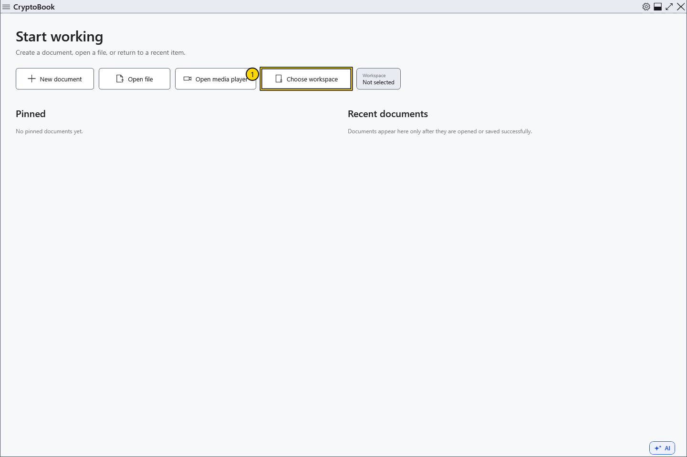
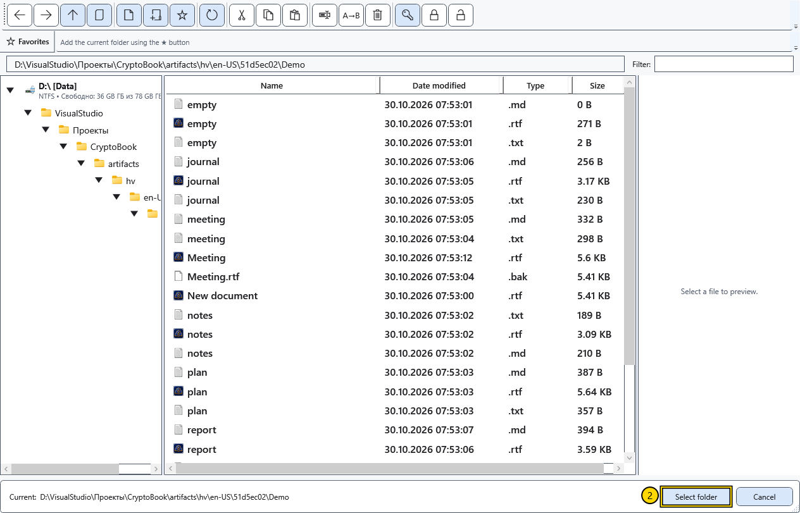
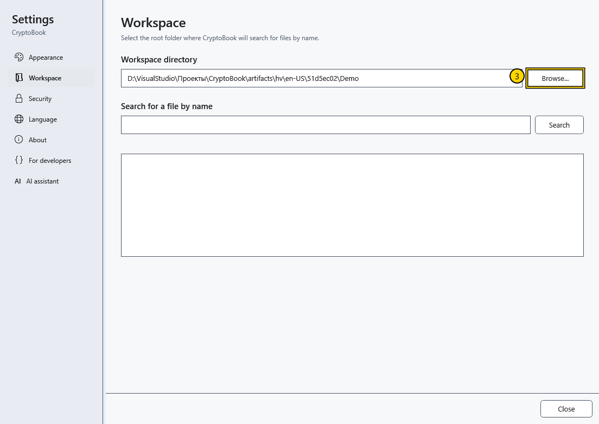

# Choose a workspace directory

The workspace directory defines the folder used to search for documents. For example, select a project folder to find its files by name or content. You do not have to choose a workspace to create or open an individual document.

## Steps

1. On the start screen, select **Choose workspace**. From an editor, use the gear button and **Settings → Workspace → Browse...**.

2. Navigate to the required local folder in the picker. Check the path at the bottom and confirm. **Cancel** keeps the previous workspace directory.

3. Open **Settings → Workspace** and check the displayed path. **Search for a file by name** is in this section; content search has its own workspace command.

## Three different paths

| Path | What it controls |
| --- | --- |
| Workspace directory | The scope of workspace searches |
| Current file manager folder | The files displayed and the destination of file operations |
| Open document folder | The file location; **Save** writes to that file |

Changing the workspace does not move, rename or save the open document in the new folder. Use **File → Save as** to change its save location.

## If something goes wrong

If a folder is unavailable, connect its drive or choose an existing local folder. An empty search result does not mean the open document was deleted: check the search scope and name first. Use the same button to choose another workspace; this does not delete files already saved.

## Related topics

- [Main window areas](help:start.interface)
- [Open a document](help:doc.open)
- [Save and Save as](help:doc.save)
- [Navigate files](help:files.navigate)
- [Search by name](help:search.name)
- [Search document content](help:search.workspace)
