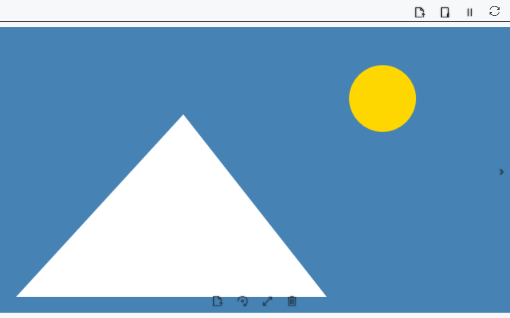

# View images in the media player

The media player opens an image in a separate window. Rotation, zoom and panning affect the view without saving a new image file.

## Before you start

> **Deletion targets the original file, including the encrypted .cbook/.cbox itself, not a decrypted copy.** The player first checks its size and available Recycle Bin capacity. If it fits, it asks to recycle the file. If the bin is missing or space is insufficient, it offers permanent deletion and waits for separate consent. Nothing is deleted before confirmation.

Use a local file or a local copy from a device. Decoding support depends on Windows.

## Steps

1. Open **Content → Photos and videos**, choose **Open in this player** and select an image. **Open in a new player** opens a selected file in another window.
2. **Previous image** / **Next image** and ←/→ move through images in the selected catalog; navigation is disabled at the ends.
3. Choose **Rotate** to rotate. The wheel and ↑/↓ zoom in/out; dragging with the left mouse button pans the image.
4. Choose **Fit image** to reset rotation, zoom and offset.
5. To delete the file, choose **Delete image** or press Delete. Wait for the capacity check and verify the original path and deletion mode in the warning. Choose **OK** for the stated action or **Cancel** to keep the file. Repeated deletion and image navigation are unavailable during the operation. Progress closes after the next image opens or the viewer is cleared.

## Editing and saving

1. Click **Edit image** (the pencil icon on the image toolbar) to open a separate editor.
2. Adjust **Contrast**, **Brightness** and **Saturation** from −100 to 100. The preview updates automatically without changing the source file.
3. Enter width and height in pixels. **Keep aspect ratio** is enabled by default and recalculates the other dimension using the original proportions. Disable it to set dimensions independently. Each side must be from 1 to 32768 pixels, with at most 100 megapixels in total.
4. **Reset** restores the original size and neutral color settings. **Cancel** closes the editor without saving.
5. Click **Save as**, then choose a path and PNG, JPEG, BMP or TIFF. To replace the source, choose its path and confirm replacement. The player opens the saved result.

The editor writes a temporary file in the destination folder, then replaces the target atomically. A write failure or cancellation before replacement preserves the existing file. Errors leave the editor open for retry. Cancelling during saving requests a stop and waits for the current writing stage to finish.

The output contains one frame without source metadata; animation and multiple pages are not retained. PNG and TIFF preserve transparency; JPEG and BMP use a white background. GIF, ICO and WebP can be converted to an offered format. Images from .cbook/.cbox are saved as **unencrypted copies**; the protected source container is preserved. Viewing rotation and zoom are separate from editor settings.

## Check the result

The image appears in the window. Image controls appear on hover and have tooltips. Unmodified arrow keys act on the image while the player window is active. After moving the file to the Recycle Bin, the player shows an adjacent image; if no images remain, the viewing area is cleared.

## Cancel and return

Choose **Cancel** in the deletion prompt to keep the original. Closing the player cancels work that has not completed yet. After recycling, open the Windows Recycle Bin, select the file and choose **Restore**, then open it in the player again. A file permanently deleted with your consent cannot be restored from the bin.

## If it did not work

No adjacent image: check the chosen catalog and file order. For decoding errors try a supported format. PDF and video use different viewing paths.

If the bin limit cannot be determined, the operation stops with a message. Declining confirmation or an error before deletion preserves the original and the current image. If deletion has already succeeded when cancellation arrives, the player advances to the next image; cancellation does not automatically restore an already deleted file.

## Related topics

- [Video and multiple player windows](help:view.video)
- [Open, rename and delete](help:files.manage)
