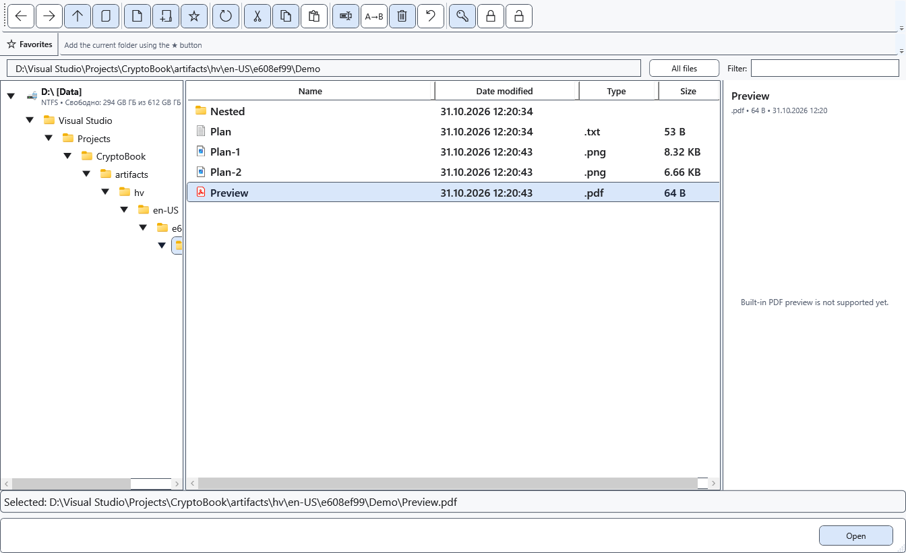

# Open PDF files

CryptoBook sends an ordinary PDF to an external Windows application. PDF does not become an editable CryptoBook document, and the built-in right panel does not display its pages.

## Before you start

An installed PDF application and a Windows file association are required. Copy files from Android locally first. Do not send a protected container to an external application as an ordinary PDF.

## Steps

1. Open the file manager and select a local PDF. The right panel reports that built-in PDF preview is unavailable.
2. Open the file using **Open**. Windows launches the associated PDF application.
3. Read, print or edit in that application. Activate CryptoBook to return.

## Check the result

The document appears in the external application if its association is available. The ordinary CryptoBook editor is not replaced with PDF pages.

## Cancel and return

Close the external window or return to CryptoBook. Any save prompt for changes made in the external application belongs to that application.

## If it did not work

If opening fails, configure the default PDF application in Windows and retry. Renaming the extension does not make PDF editable in CryptoBook. Explicitly decrypt a protected PDF into a suitable location first; the resulting file is unencrypted.

## Related topics

- [Open a document](help:doc.open)
- [Formats and encodings](help:doc.formats)
