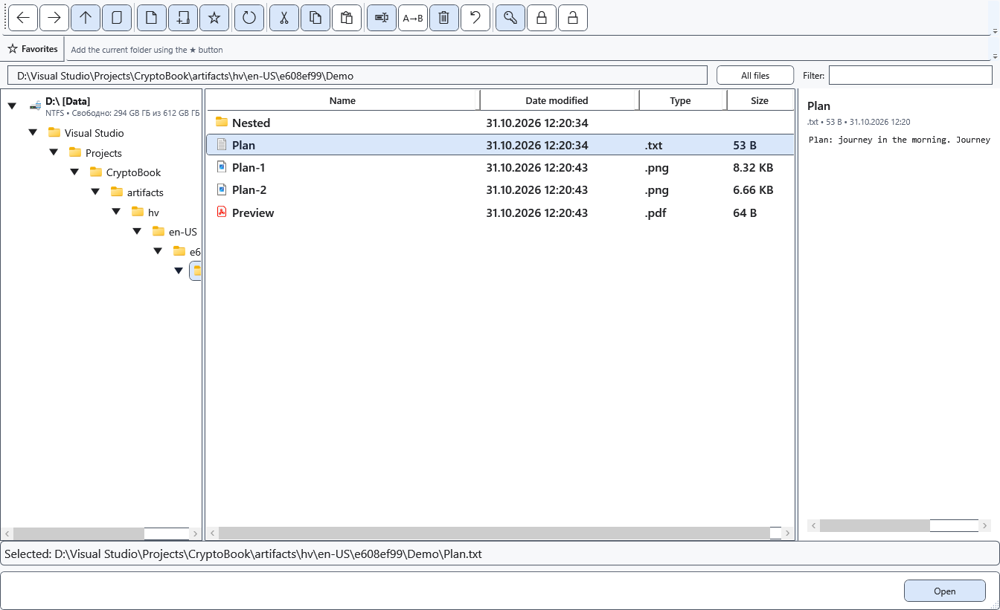
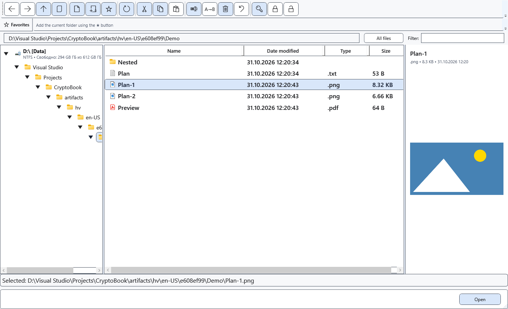

# Preview files in the file manager

The file manager’s right panel lets you read text or inspect an image without opening a separate editor.

## Before you start

Select one file. A local protected file requires a suitable key already entered. Android preview reads the original stream and does not automatically decrypt it.

## Steps

1. Open the file manager and browse to a folder.
2. Select one file in the list. Check its name, type, size and content, or the limitation message in the right panel.
3. Select another file to change the preview. Open the file with an appropriate command for editing or a full view.

## Check the result

Text preview supports TXT, LOG, MD, CS, XAML, JSON, XML, YAML/YML, INI, CONFIG, CSV and TSV, reading the first 512 KiB. PNG, JPG/JPEG, BMP, GIF and WEBP images are limited to 32 MiB; decoding depends on Windows support. This is not a full RTF or PDF viewer.

## Cancel and return

Select a folder or another file, or close the window. Preview does not write file changes.

## If it did not work

Oversized files, unsupported formats, a wrong key or a disconnected device produce a message instead of content. Local protected preview is limited to 32 MiB and supported content. Explicitly decrypt a remote protected file or copy it locally first.

## Related topics

- [Navigate folders](help:files.navigate)
- [Device capabilities and limits](help:devices.limits)
- [View images in the media player](help:view.images)
