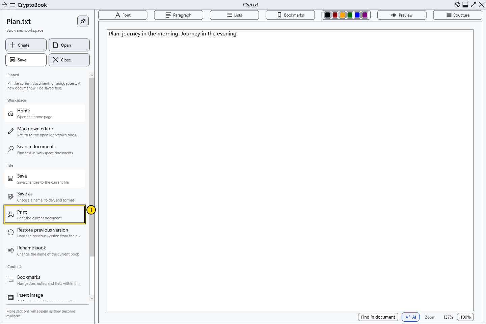

# Print the current document

Print sends the current document to the system dialog. Ordinary documents retain formatting; Markdown is first rendered into a displayed document.

## Before you start

Activate the intended ordinary or Markdown document. It must contain nonempty printable content. Check the selected printer, paper and device availability. Printing may expose protected content on paper or in an output file.

## Steps

1. In the side menu, choose **File → Print**.
2. In the Windows dialog, select the printer and its available options. The dialog language and fields depend on Windows and the driver.
3. Check the destination, then confirm printing or cancel the system dialog.

## Check the result

After confirmation the job is sent to the selected printer. Its printable area determines layout and may differ from the screen. The current document is printed as a whole; selecting text does not itself restrict the range. Print PDF from its external viewer.

## Cancel and return

Cancelling before confirmation sends no job. After sending, use the Windows print queue or printer controls; closing CryptoBook does not guarantee cancellation.

## If it did not work

Disabled command: check that a document and content exist. For printing errors, check the driver, queue and printer connection. An on-screen preview does not confirm physical output or exact paper layout.

## Related topics

- [Page settings and paper colour](help:edit.page)
- [Preview, pages and zoom](help:edit.view)
