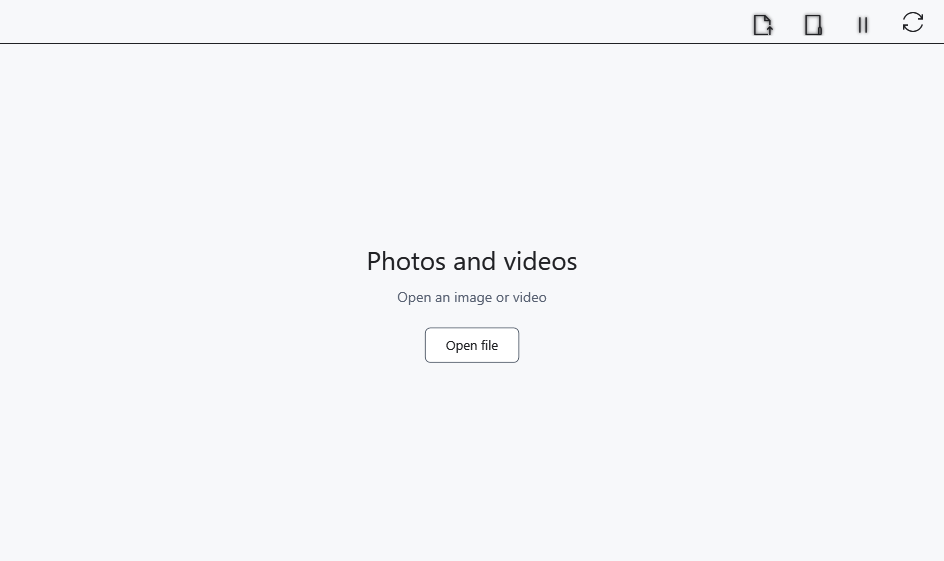

# Video and multiple player windows

The media player opens video in its own window. A file’s container, codec and available decoding determine support; its extension alone does not guarantee playback.

## Before you start

Use a local video or a local copy from a device. Open the window through **Content → Photos and videos** or the home-page button.

## Steps

1. Choose **Open in this player** and select a video. **Open in a new player** opens a selected file in another window.
2. Use the Flyleaf controls in the video area for play/pause, the timeline and sound. Move the pointer over the video if controls are hidden.
3. With focus in the video area, ←/→ seek; Alt+←/→ select the previous/next video in the catalog when available.
4. **Pause all players** pauses players. **Synchronize playback (experimental)** enables experimental coordination between windows; disable it for independent control.

## Check the result

Successful playback shows video frames and an advancing position. Adjacent-file navigation uses the chosen catalog, not every video on the PC. Synchronization does not promise exact frame alignment between windows.

## Cancel and return

Pause, open another file or close the window. Closing the player does not delete video. Disable synchronization to return to independent control.

## If it did not work

No picture or an error message: check a local copy, file integrity and codec support. Keys depend on focus; text-editor shortcuts do not automatically apply to Flyleaf. Its timeline and extra controls may use the player’s own styling.

## Related topics

- [View images in the media player](help:view.images)
- [Device capabilities and limits](help:devices.limits)
