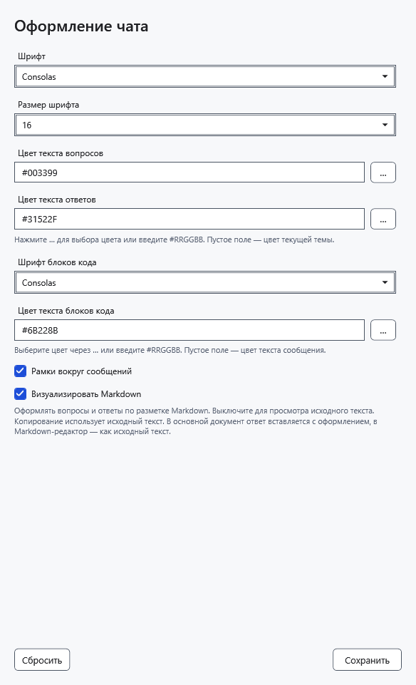
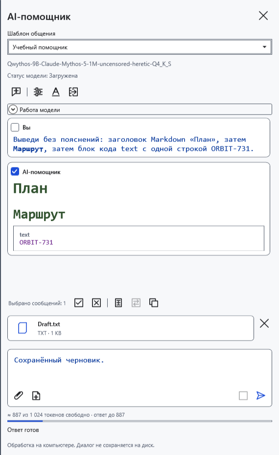
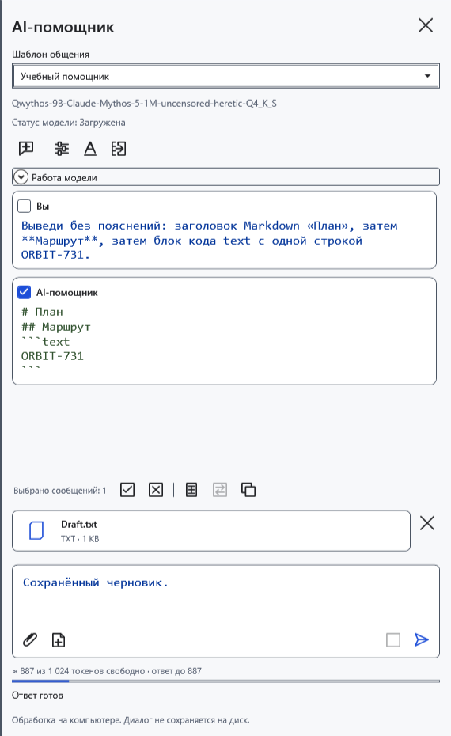
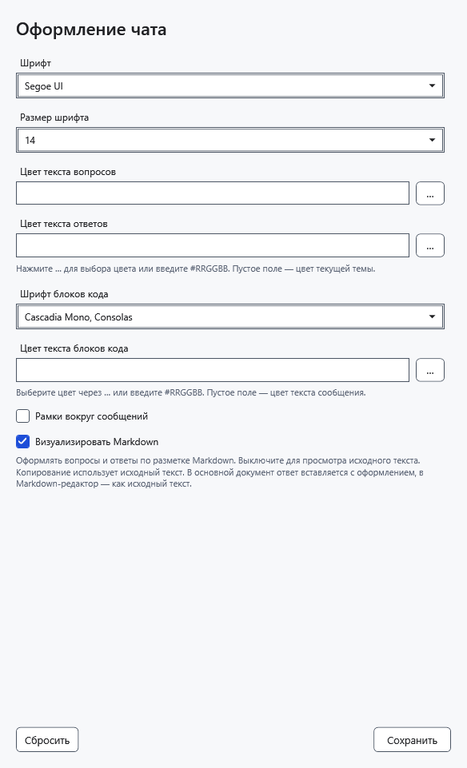

# Оформление чата AI

Шрифты, цвета и Markdown меняют отображение чата, сохраняя исходный ответ, переписку, черновик и вложения. Настройки оформления общие для моделей. Их сохранение не выгружает модель и не останавливает текущий ответ.

## Изменить оформление

1. В верхней части панели помощника нажмите **Оформление чата** — значок A.
2. Выберите **Шрифт** и **Размер шрифта** от 8 до 40. Эти параметры применяются к сообщениям, полю вопроса и рассуждениям. Для блоков кода есть отдельный шрифт.
3. Задайте цвета вопросов, ответов и кода в формате **#RRGGBB**, например `#31522F`. Кнопка выбора цвета открывает системный диалог. Пустое поле цвета возвращает цвет темы; пустой цвет кода наследует цвет соответствующего сообщения.
4. При необходимости включите **Рамки вокруг сообщений**. По умолчанию они выключены.

5. Нажмите **Сохранить**. Уже полученные ответы перерисуются с выбранными параметрами.

## Markdown и исходный текст

**Визуализировать Markdown** по умолчанию включено: заголовки, списки, таблицы и код отображаются оформленными. Если выключить флажок и сохранить, виден исходный Markdown со знаками разметки.

**Копировать** берёт исходный текст ответа в обоих режимах. Этот флажок не управляет оформленным переносом в обычный редактор; тот имеет свои правила. HTML не исполняется, внешние изображения из Markdown не загружаются. Оформление не делает сгенерированный код безопасным для запуска.

## Сбросить и отменить

6. Откройте окно и нажмите **Сбросить**: появятся стандартные параметры — размер 14, без рамок, с Markdown и цветами темы. Нажмите **Сохранить**, чтобы применить их.

Закрытие окна без сохранения отбрасывает изменения, включая сброс. Если цвет введён неверно, исправьте его или очистите поле и сохраните снова. Если нужного шрифта нет в списке, выберите установленный. Слишком мелкий текст увеличьте через размер шрифта; эти параметры не меняют размер текста документа.

- [Чат и копирование](help:ai.chat)
- [Перенос ответа в документ](help:ai.apply)
- [Общий вид приложения](help:settings.appearance)
