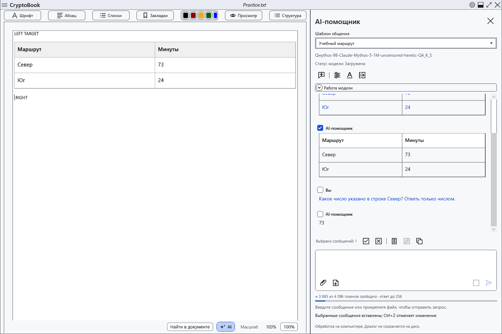
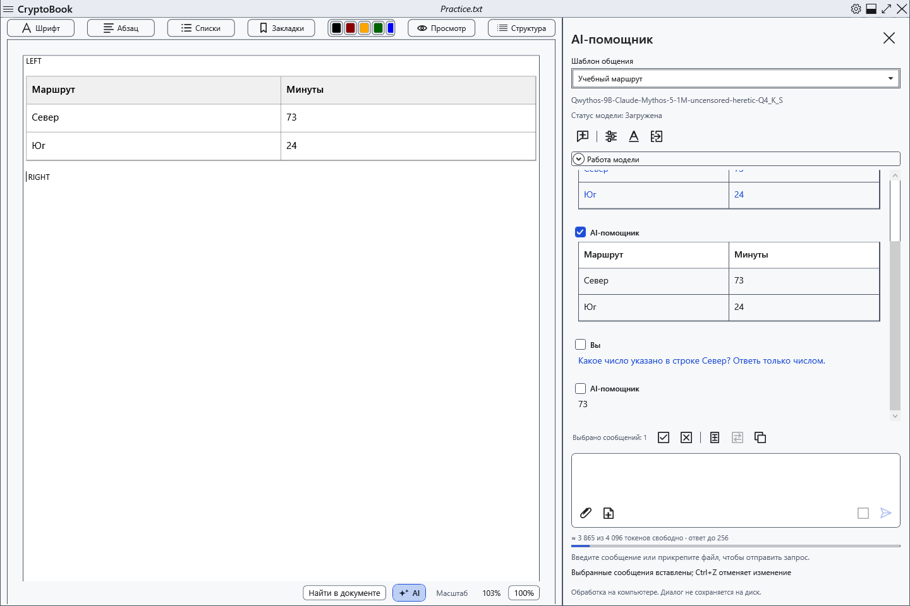
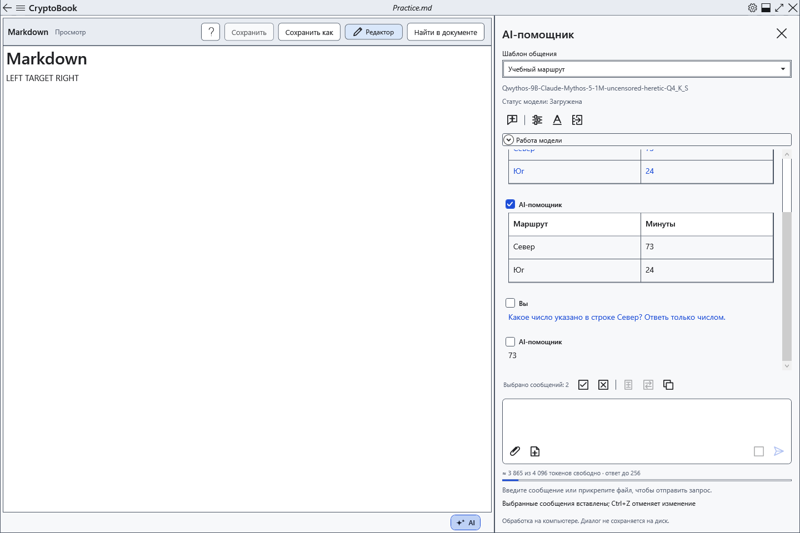
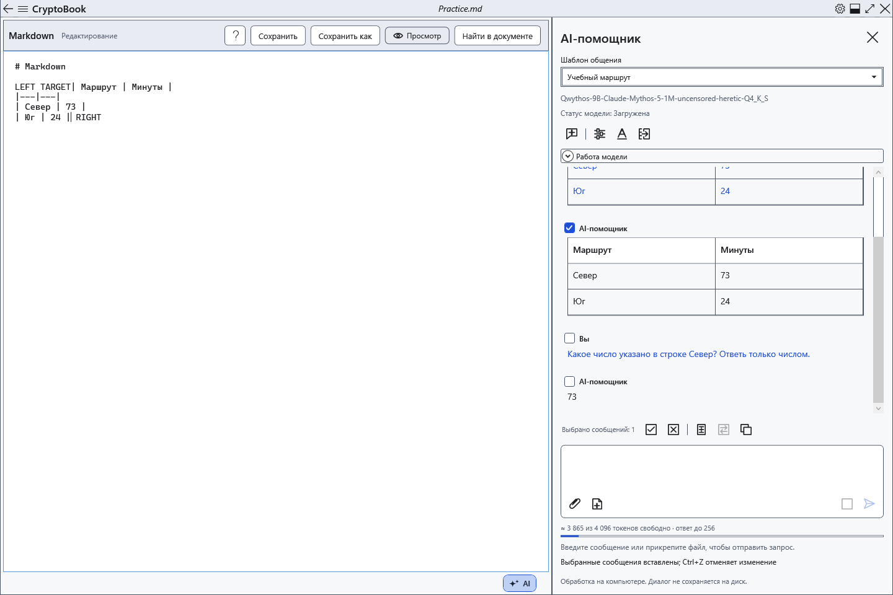

# Перенести ответы в документ

**Вставить выбранное** и **Заменить выделение** переносят отмеченные сообщения из чата в текущий редактор. Документ, курсор и выделение можно выбрать после получения ответа. Проверьте текст модели перед переносом.

## Обычный редактор

1. Отметьте нужные сообщения в AI-панели. Одно переносится без добавленной подписи; несколько — в порядке диалога, с подписями участников и разделителями. Рассуждения и содержимое вложений в перенос не входят.
2. Откройте обычный документ для редактирования. Поставьте курсор или выделите текст.
3. Нажмите **Вставить выбранное**: ответ появится в позиции курсора, а при наличии выделения — после него. Выделенный текст сохранится.

4. Чтобы заменить выбранный фрагмент, сначала проверьте выделение: команда удалит именно его. Нажмите **Заменить выделение**. Без выделения она недоступна.

Обычный редактор преобразует Markdown в редактируемые заголовки, выделение, списки, код и таблицы. Ячейки можно исправлять отдельно; это не меняет исходный ответ в чате. Повторная вставка остаётся доступной и добавляет содержимое ещё раз. HTML инертен; картинки из разметки AI не загружаются. Файлы-картинки нужно вставлять средствами редактора.

## Markdown

5. Перейдите к нужному Markdown-документу. Если открыт **Просмотр**, нажмите **Редактор**. Из просмотра обе команды переноса недоступны.

6. В исходнике поставьте курсор/выделение и нажмите ту же команду. Вставляется исходный Markdown выбранных сообщений, а не оформленный WPF-фрагмент. Переключитесь в **Просмотр**, чтобы проверить результат.

Переносы строк автоматически не добавляются. Для отдельной таблицы или заголовка подготовьте границы блока в исходнике: вставка посреди строки может оставить разметку обычным текстом.

## Проверить, отменить и сохранить

Команды меняют документ в памяти, без автоматической записи файла. Проверьте место вставки и окружающий текст. Один Ctrl+Z в соответствующем редакторе отменяет всю вставку или замену, Ctrl+Y повторяет её. Затем используйте обычное сохранение. Для сохранения оформления обычного документа выберите подходящий формат; TXT оставляет только текст.

При отсутствии отметок выберите сообщения. При недоступной вставке откройте редактируемый документ, выйдите из просмотра/режима чтения и дождитесь конца ответа. Блокировка запрещает перенос. Если документ изменился во время применения, прочитайте ошибку и заново проверьте цель: не рассчитывайте на прежний курсор другого документа.

- [Выбор сообщений](help:ai.chat)
- [Таблицы документа](help:content.tables)
- [Редактирование Markdown](help:md.edit)
- [Форматы документов](help:doc.formats)
- [Сохранение](help:doc.save)
