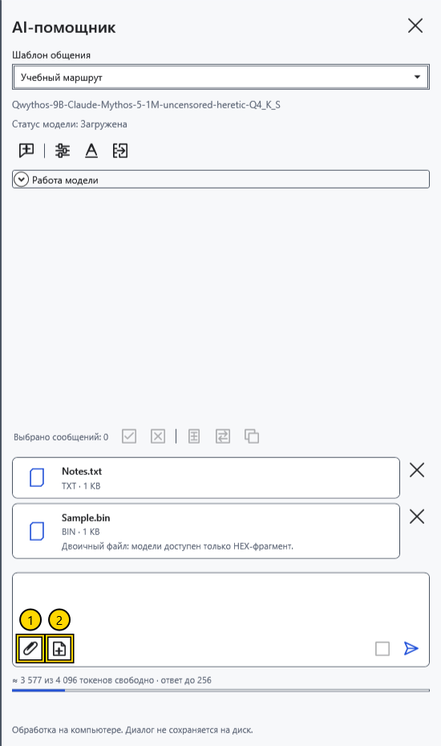
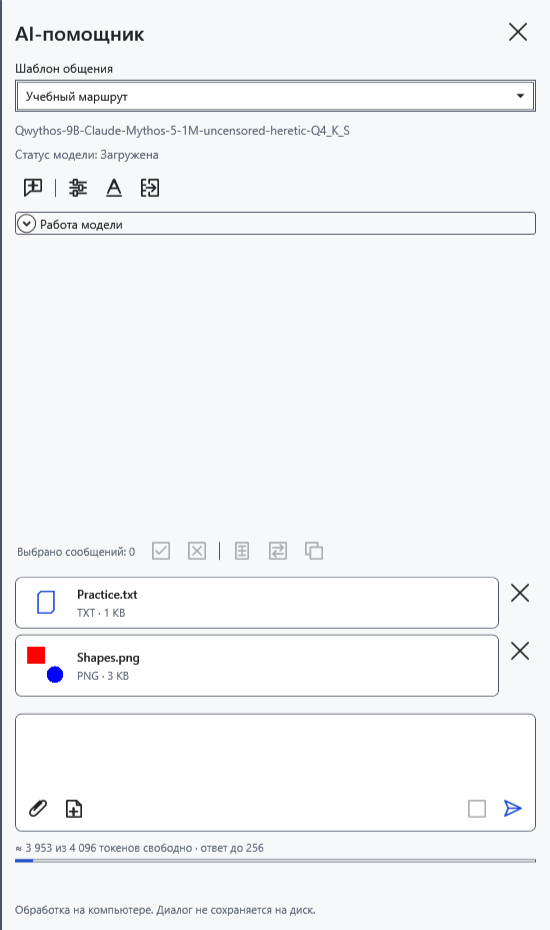
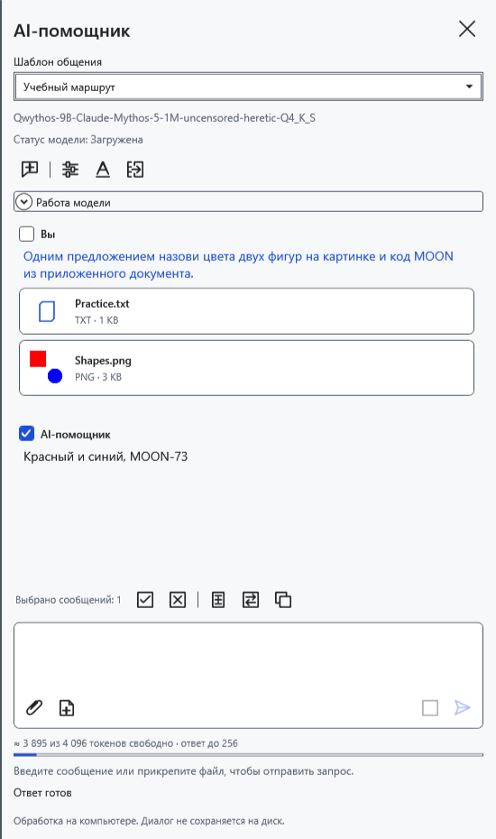
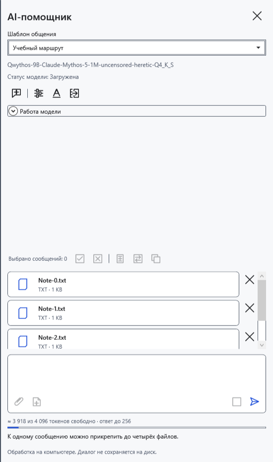

# Прикрепить файлы и текущий документ

Вложения добавляют сведения к вопросу. Выбирайте файлы, которые намерены передать локальной модели. Карточка файла не означает, что программе удалось извлечь всё его содержимое.

## Добавить и убрать

1. Нажмите **Прикрепить файлы…** (1) у поля запроса. В системном выборе доступны документы/изображения и **Все файлы** (`*.*`). Можно выбрать несколько файлов или перетащить их на панель.
2. Проверьте карточки. До отправки крестик **Убрать вложение** удаляет соответствующую карточку.

Текст, Markdown, RTF, DOCX и XamlPackage передаются как извлечённый текст. Оформление и встроенные картинки документа не становятся изображениями для vision. Для неизвестного расширения программа пытается прочитать текст; двоичный файл получает ограниченную HEX-выборку первых 256 байт вместе с именем и размером. Это не полный разбор PDF, архива или другого двоичного формата. Для защищённого документа сначала откройте его обычным способом и используйте снимок текущего документа.

## Приложить документ и изображение

3. Откройте нужный документ и нажмите **Текущий документ** (2). Прикладывается текст всего документа на этот момент, включая несохранённые правки, а не только выделение. В Markdown это исходный текст. Последующее редактирование не обновляет уже созданную карточку: уберите её и приложите заново.
4. Для картинки прикрепите отдельный PNG/JPEG/BMP/GIF/TIFF. Нужны поддерживающая зрение модель и совместимый единственный mmproj рядом с GGUF.

5. Введите вопрос и нажмите **Отправить**. Без текста вопроса используется стандартный запрос о файлах. После отправки карточки переходят в историю; уточнения того же чата используют прежние вложения.

## Ограничения и ошибки

К одному сообщению — до четырёх файлов; отдельный файл — до 32 МиБ; извлечённый текст — до 500000 символов; изображение до уменьшения — до 100 мегапикселей. Программа уменьшает крупные картинки для обработки; мелкие детали могут теряться. Вложения и история занимают контекст модели: допустимый файл всё равно может не поместиться в конкретный запрос.

При ошибке лимита ранее добавленные карточки остаются: уберите лишнее и повторите. Пустой/слишком большой файл, ошибка чтения или повреждённая картинка не добавляются. Пока файлы читаются или идёт ответ, дождитесь завершения. Убрать уже отправленный файл из истории отдельно нельзя; **Новый чат** удаляет всю переписку, черновик и вложения без архивирования. Сначала сохраните нужные ответы. При закрытии приложения и сбросе ключа вложения также теряются.

- [Чат](help:ai.chat)
- [Модель и vision-проектор](help:ai.models)
- [Перенос ответа](help:ai.apply)
- [Ошибки помощника](help:ai.troubleshoot)
- [Контекст](help:ai.context)
