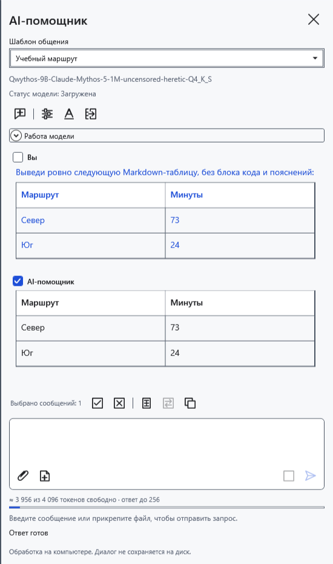
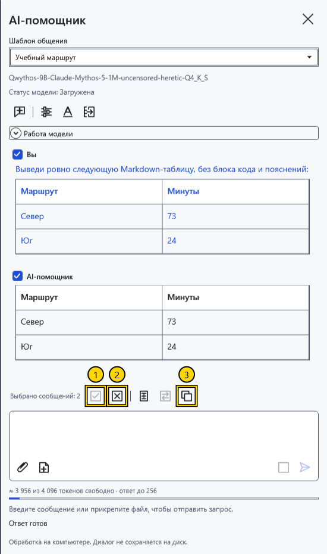
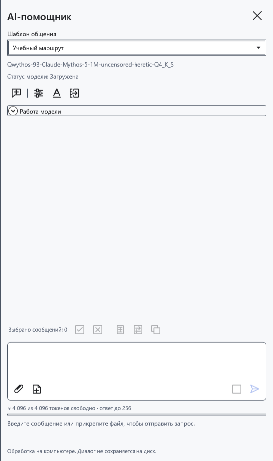

# Общаться с помощником и выбирать сообщения

Чат находится в правой AI-панели. Вопросы, ответы и отправленные вложения образуют текущую историю для следующих запросов. Отметки сообщений управляют копированием и переносом в редактор; они не исключают остальные сообщения из контекста модели.

## Отправить вопрос

1. Включите помощник и выберите модель. Введите вопрос внизу панели.
2. Нажмите **Отправить** или Ctrl+Enter в поле ввода. Обычный Enter добавляет строку. Во время ответа дождитесь завершения либо нажмите **Остановить**.
3. Прочитайте полученный ответ и проверьте факты. Задайте уточнение в том же чате, чтобы использовать предыдущую переписку.

Ответ появляется постепенно. Если модель выдаёт отдельные рассуждения, их можно раскрыть в **Рассуждения модели**; они отделены от итогового текста. При пустом ответе прочитайте сообщение состояния. Настройки рассуждений зависят от модели.

## Выбрать и скопировать

Отметьте флажки у **Вы** и **AI-помощник**. Можно выбрать вопрос, ответ или несколько сообщений. До ручного изменения выбора автоматически отмечается последний непустой ответ; ручные отметки сохраняются при следующем запросе.

1. **Выбрать всё** отмечает все сообщения с непустым текстом.
2. **Снять выбор** убирает отметки; копирование и перенос становятся недоступны.
3. **Копировать** помещает исходный текст выбранных сообщений в буфер обмена.

Одно сообщение копируется без добавленной подписи. Несколько идут в порядке диалога, с подписями участников и разделителями. Сохраняется исходный Markdown, даже если чат показывает оформленную таблицу. Рассуждения и содержимое вложений в копию не входят. **Вставить выбранное** и **Заменить выделение** используют тот же выбор.

## Начать заново

Перед **Новый чат** перенесите нужные ответы в документ: команда без архивирования удаляет переписку, черновик, вложения, отметки и вычислительный кеш. Она сохраняет загруженные веса модели; скрытие панели также не архивирует чат. Переписка не сохраняется между запусками и очищается при сбросе ключа.

Если копирование не удалось, проверьте сообщение состояния и повторите команду. При недоступной отправке прочитайте пояснение под запросом.

- [Включить помощник](help:ai.start)
- [Шаблоны общения](help:ai.templates)
- [Вложения](help:ai.attachments)
- [Перенести ответ в документ](help:ai.apply)
- [Остановка и выгрузка](help:ai.lifecycle)
