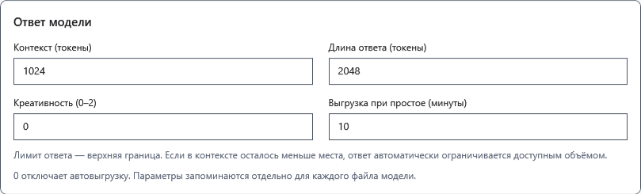
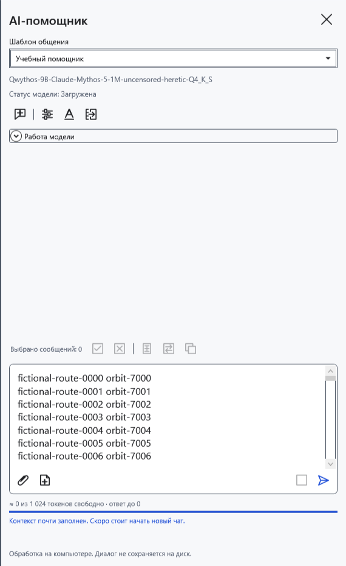
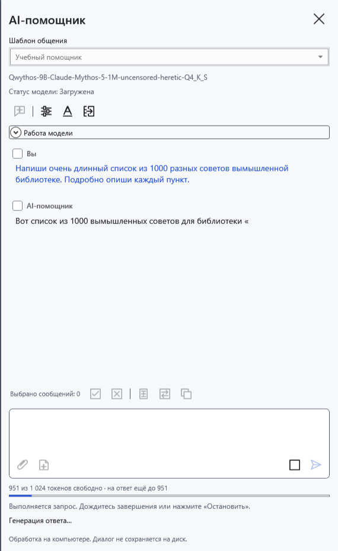
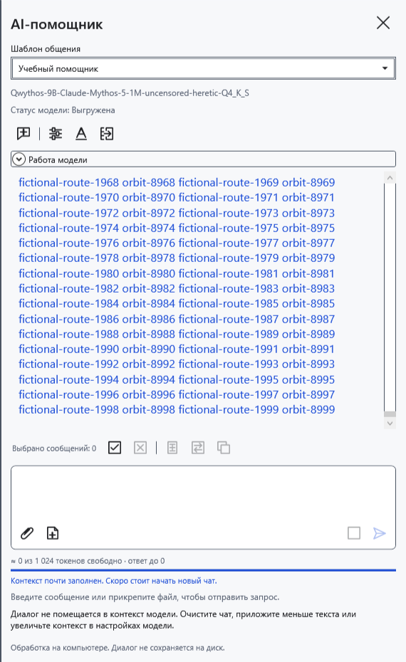
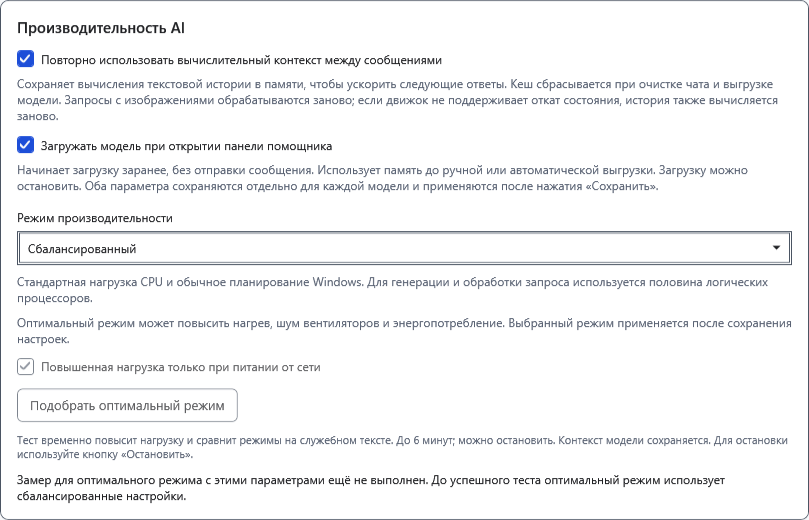
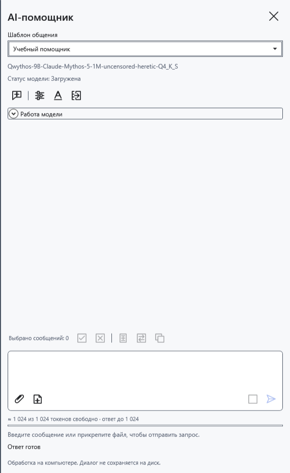

# Контекст, лимит ответа и предзагрузка

Контекст — общее окно токенов для инструкций шаблона, истории, вопроса, вложений и нового ответа, включая рассуждения. Токен не равен символу или слову. Длинный ответ возможен только в оставшейся части этого окна.

## Задать пределы

1. Откройте **Настройки модели**, выберите нужный GGUF и прокрутите к параметрам ответа.
2. Задайте **Контекст (токены)**: 512–131072, в пределах возможностей самой модели и памяти компьютера. Большее значение требует больше памяти и не улучшает модель автоматически.
3. Задайте **Длина ответа (токены)**: 1–131072. Это верхняя граница, а не заказ на точное количество текста. Она может превышать контекст, но фактический ответ всё равно ограничен его свободным остатком. Модель также может закончить раньше.
4. **Креативность (0–2)** влияет на выбор продолжения; она не является регулятором скорости. Нажмите **Сохранить**. Изменение параметров ответа начинает новый чат: заранее сохраните нужный текст.

Параметры ответа сохраняются отдельно для каждого файла модели. Шаблоны общения общие: переключение шаблона не создаёт новую модель.

## Читать индикатор

До отправки и после завершения ответа знак **≈** означает оценку. Она учитывает введённый черновик и вложения, но может отличаться от разбиения токенизатором модели. При пустом новом чате показано всё свободное окно, хотя будущие инструкции тоже займут место.

Во время генерации индикатор использует фактические данные движка: входные и уже выданные токены, включая рассуждения. Остаток для ответа уменьшается по мере генерации. Если автоматический режим памяти уменьшил контекст, действующий размер виден в **Работа модели**, а не только в сохранённом поле настройки.

Если реальный запрос не помещается, появляется сообщение о заполненном контексте. Предварительная оценка не гарантирует успешную отправку. Уменьшите вопрос/вложения либо начните **Новый чат**. Он без архивирования удаляет переписку, черновик и вложения, очищает вычислительный кеш, но сохраняет загруженные веса. Нужный ответ сначала скопируйте.

## Повторное использование и предзагрузка

В **Настройки модели → Производительность AI** есть два независимых флажка. Оба выключены по умолчанию и действуют после **Сохранить** отдельно для выбранной модели.

- **Повторно использовать вычислительный контекст между сообщениями** сохраняет вычисления совпадающего текстового начала следующего запроса. Выигрыш зависит от модели и совпадения начала; изменение инструкции или ранней реплики может потребовать пересчёта. Если движок не поддерживает откат состояния этой модели, история тоже вычисляется заново. Изображения обрабатываются заново. Это не увеличение контекста, не долговременная память и не архив чатов. Новый чат и выгрузка очищают кеш.
- **Загружать модель при открытии панели помощника** переносит загрузку весов на открытие панели. Вопрос сам не отправляется, но память уже занята. При необходимости остановите загрузку или выгрузите модель. Следующее открытие панели может снова запустить предзагрузку.

До сохранения используйте **Отмена** или закройте окно, чтобы отбросить изменения. Для возврата отключите флажки и сохраните; для немедленного освобождения памяти нажмите **Выгрузить модель**. Закрытие панели обычно сохраняет веса.

- [Чат и новый запрос](help:ai.chat)
- [Режимы памяти](help:ai.memory)
- [Загрузка и выгрузка](help:ai.lifecycle)
- [Шаблоны общения](help:ai.templates)
