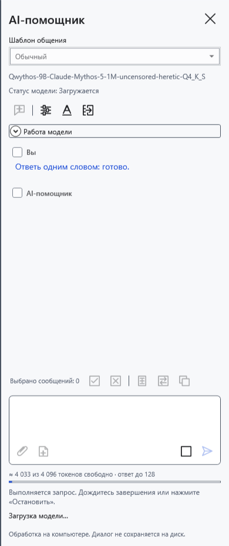
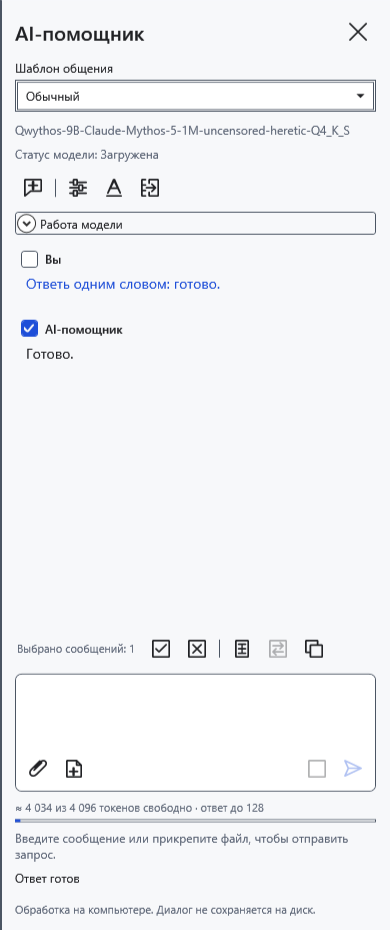
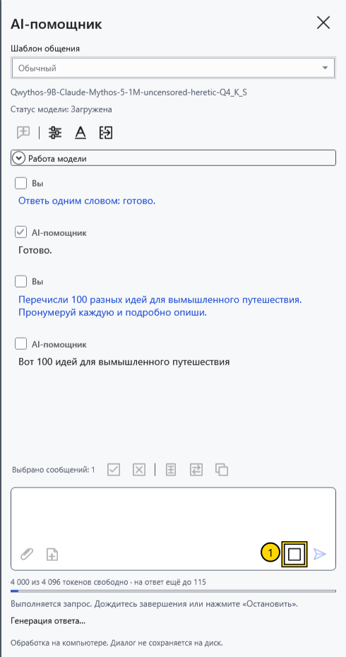
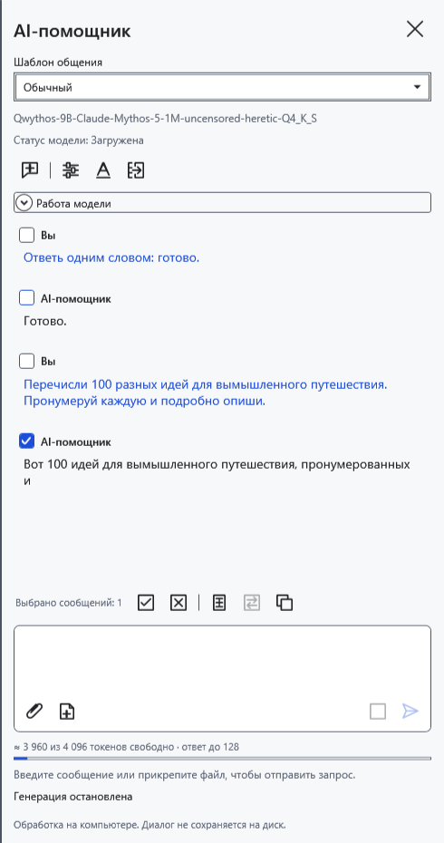
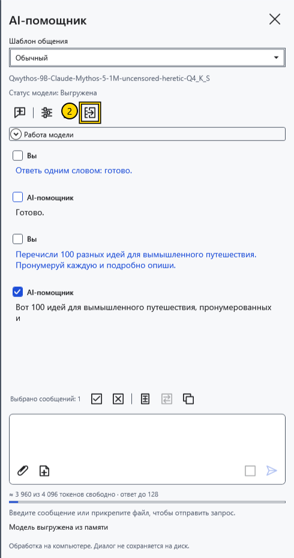

# Загрузка, остановка и выгрузка модели

**Статус модели** под её именем показывает состояние весов. Текст хода операции и ошибок расположен отдельно. **Загружена** не означает, что ответ ещё генерируется: модель может просто ждать следующего запроса.

## Загрузка и завершение ответа

Выберите и сохраните модель, затем отправьте вопрос. Обычно первый запрос загружает веса. Если включено **Загружать модель при открытии панели помощника**, загрузка начинается уже при открытии панели. Во время загрузки и ответа память и процессор могут быть заняты.

Дождитесь конца ответа. **Отправить** снова станет доступна после ввода следующего вопроса, а веса останутся загруженными для продолжения.

## Остановить текущий ответ

1. Во время генерации нажмите **Остановить** (1) у поля запроса.

Дождитесь завершения остановки. Полученный текст остаётся в чате; он может обрываться посреди предложения. При обычной согласованной остановке веса сохраняются. Это отличается от отмены первоначальной загрузки: она освобождает модель. Если отдельный процесс модели не подтверждает остановку примерно за пять секунд, CryptoBook завершает его принудительно, и перед следующим запросом потребуется загрузка.

## Освободить память

2. Нажмите значок **Выгрузить модель** (2) в верхней части панели. Он отменяет текущую работу и освобождает языковую модель и vision-проектор. Дождитесь состояния **Выгружена**. Уже полученная переписка остаётся; следующий вопрос снова загрузит модель.

В **Настройки модели → Выгрузка при простое (минуты)** задайте интервал 0–120; по умолчанию 10 минут, 0 отключает автовыгрузку. Настройка интервала общая, хотя параметры ответа сохраняются по моделям. Автовыгрузка ждёт отсутствия активной операции; таймер проверяет простой периодически, поэтому это не секундомер. Закрытие панели обычно сохраняет веса; закрытие приложения освобождает их. Сброс ключа прекращает AI, очищает чат и выгружает модель.

**Новый чат** удаляет переписку, черновик, вложения и вычислительный кеш без архивирования, сохраняя загруженные веса. Не путайте его с выгрузкой. Неожиданное завершение отдельного процесса обнаруживается и в простое: статус меняется на **Выгружена**. Полученный ответ остаётся; при необходимости отправьте новый запрос. После ошибки с частичным ответом программа не повторяет его автоматически.

- [Выбрать модель](help:ai.models)
- [Ошибки помощника](help:ai.troubleshoot)
- [Контекст и предзагрузка](help:ai.context)
- [Сброс ключа](help:security.lock)
