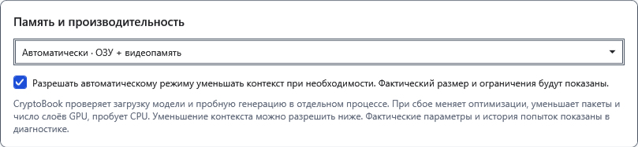
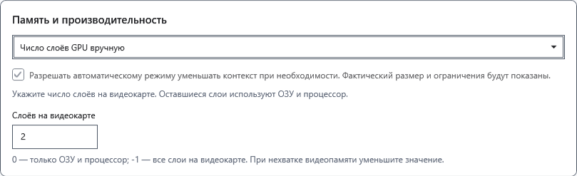
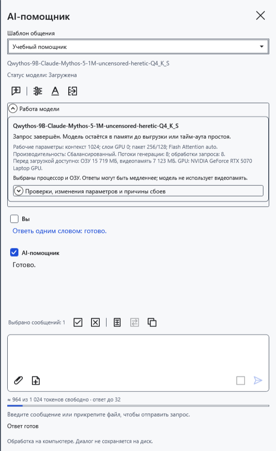
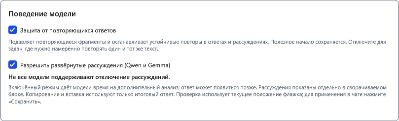
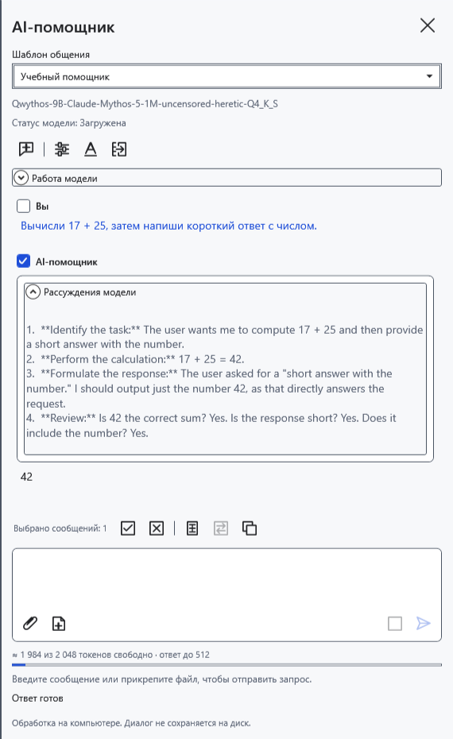

# Память, GPU и поведение ответа

Параметры сохраняются отдельно для выбранного файла GGUF. Сначала сохраните нужные ответы: изменение контекста, режима памяти или поведения ответа может очистить текущий чат и потребовать новой загрузки.

## Выбрать размещение модели

1. Откройте **Настройки модели → Дополнительные параметры → Память и производительность**.
2. Начните с **Автоматически · ОЗУ + видеопамять**. Программа подбирает размещение по доступной памяти; при неудачной загрузке может уменьшить число слоёв GPU или перейти на CPU. Это не гарантия, что любая модель поместится.
3. Если допустимо, включите разрешение автоматическому режиму уменьшать контекст. Тогда фактическое окно может стать меньше заданного. Без этого разрешения большой контекст не должен молча уменьшаться. Проверяйте размер и предупреждения в **Работа модели**.

4. Для ручного выбора используйте **Число слоёв GPU вручную** и поле **Слоёв на видеокарте**. Значение 0 оставляет слои на CPU; −1 запрашивает все слои на GPU; положительное число запрашивает столько слоёв. «Все» не означает, что памяти хватит. Поддержка зависит от модели, драйвера и оборудования.

5. Для работы без выгрузки слоёв на GPU выберите **Только процессор · ОЗУ**. Нажмите **Сохранить**, отправьте короткий вопрос и раскройте **Работа модели**. Сравните фактические GPU-слои, контекст и потоки с ожиданиями. CPU может быть медленнее; ОЗУ по-прежнему нужна.

При нехватке памяти уменьшите контекст, выберите меньший GGUF или выгрузите ненужную модель. Не увеличивайте слои GPU только ради скорости. Программа не закрывает другие приложения. Автоуменьшение не применяется к замеру производительности: он проверяет выбранный размер контекста.

## Рассуждения и защита повторов

В том же разделе найдите параметры поведения:

- **Разрешить развёрнутые рассуждения (Qwen и Gemma)** разрешает поддерживаемой модели выдавать анализ. Флажок не добавляет эту способность другим моделям и не гарантирует, что конкретный GGUF будет ему следовать. Рассуждения занимают время и общий контекст. Отключение не гарантирует отсутствия любого объяснения в обычном ответе.
- **Защита от повторяющихся ответов** сочетает ограничение повторов при выборе токенов и остановку устойчивого точного зацикливания. Полученное полезное начало остаётся. Перефразирование одного смысла может не распознаваться. Если намеренно нужны одинаковые строки, временно отключите защиту и затем включите снова.

Если модель передаёт отдельный анализ, его можно раскрыть в сообщении. При копировании и переносе используется ответ, без отдельно размеченных рассуждений. Не всякий GGUF выдаёт такой канал; отсутствие раскрывающегося блока само по себе не ошибка.

До сохранения нажмите **Отмена**. После сохранения верните прежние значения и сохраните заново; очищенную переписку это не восстанавливает. Если ручной режим не загружается, вернитесь к автоматическому или CPU и проверьте коротким запросом.

- [Контекст и лимит ответа](help:ai.context)
- [Производительность и замер](help:ai.performance)
- [Выбор и проверка модели](help:ai.models)
- [Ошибки помощника](help:ai.troubleshoot)
