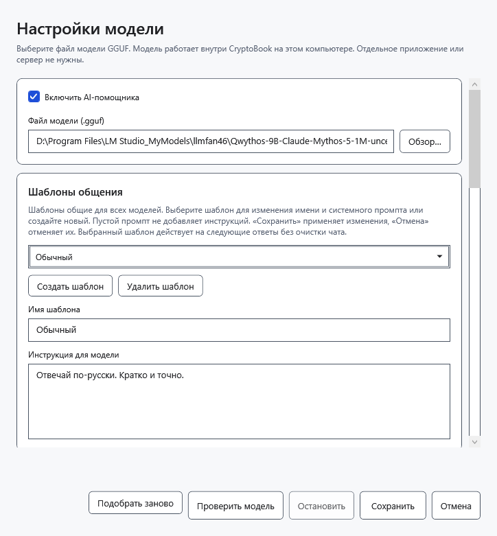
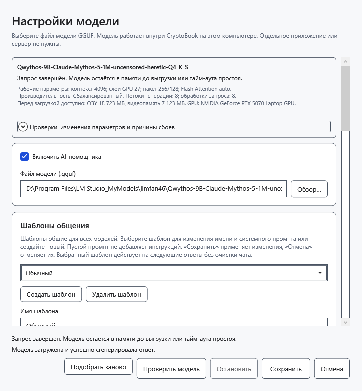
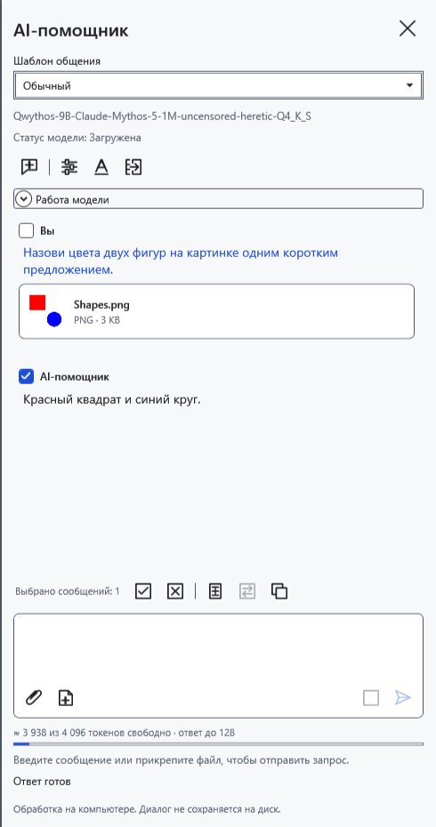

# Выбрать и проверить модель

Языковая модель — локальный файл `.gguf`. Выбирайте файл самой модели, а не вспомогательный `mmproj`. Поддержка конкретной архитектуры и достаточность памяти проверяются запуском; одно расширение GGUF не гарантирует совместимость.

## Настроить модель

Перед сменой модели перенесите нужные ответы в документ: смена модели очищает чат, черновик и вложения и выгружает прежние веса.

1. Откройте **Настройки → AI-помощник → Настройки модели** либо шестерёнку в панели.
2. Отметьте **Включить AI-помощника**. Нажмите **Обзор…** у поля **Файл модели (.gguf)** и выберите существующий языковой GGUF. Можно также ввести полный путь или выбрать ранее настроенную модель из списка, который появляется при наличии нескольких моделей.
3. При желании нажмите **Проверить модель**. Проверка использует текущие значения окна, действительно загружает модель и просит короткий ответ. **Остановить** отменяет проверку. Успех текстовой проверки ещё не подтверждает работу изображений.
4. Нажмите **Сохранить**, чтобы применить параметры и закрыть окно. **Отмена** или закрытие окна отбрасывает несохранённые правки; уже выполненная проверка могла оставить модель загруженной.

## Если нужны изображения

Нужны модель с поддержкой зрения и совместимый с ней проектор. Положите ровно один GGUF с `mmproj` в имени рядом с языковым GGUF. CryptoBook ищет его автоматически; отдельного поля выбора проектора нет. При отсутствии или нескольких таких файлах отправка изображения не сработает. Программа не определяет совместимость по одному имени: неподходящий проектор может дать ошибку обработки.

После сохранения прикрепите безопасную тестовую картинку и спросите о видимых деталях. Только реальный ответ на изображение проверяет эту возможность. Кодировщик изображения использует CPU и оперативную память; обработка может занять больше времени, чем текстовый ответ.

## Сохранение и ошибки

Параметры запоминаются для каждого файла модели; шаблоны общения общие для всех моделей. **Подобрать заново** повторяет автоматический подбор памяти; это не загрузка новой версии GGUF и не подбор максимальной скорости. После проверки либо смены настроек при необходимости используйте **Выгрузить модель** в панели. Если файл перемещён, выберите его новый путь. При ошибке сохранения окно остаётся открытым: исправьте причину или нажмите **Отмена**.

- [Включить помощник](help:ai.start)
- [Жизненный цикл модели](help:ai.lifecycle)
- [Диагностика ошибок](help:ai.troubleshoot)
- [Вложения](help:ai.attachments)
- [Память модели](help:ai.memory)
