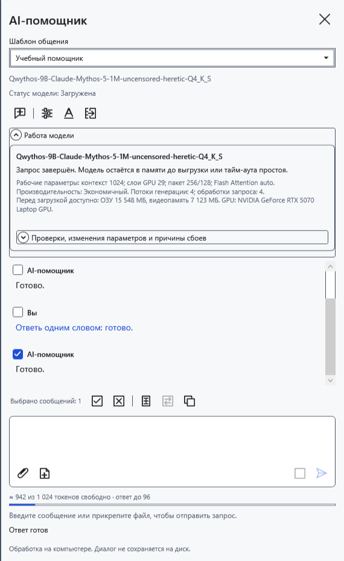
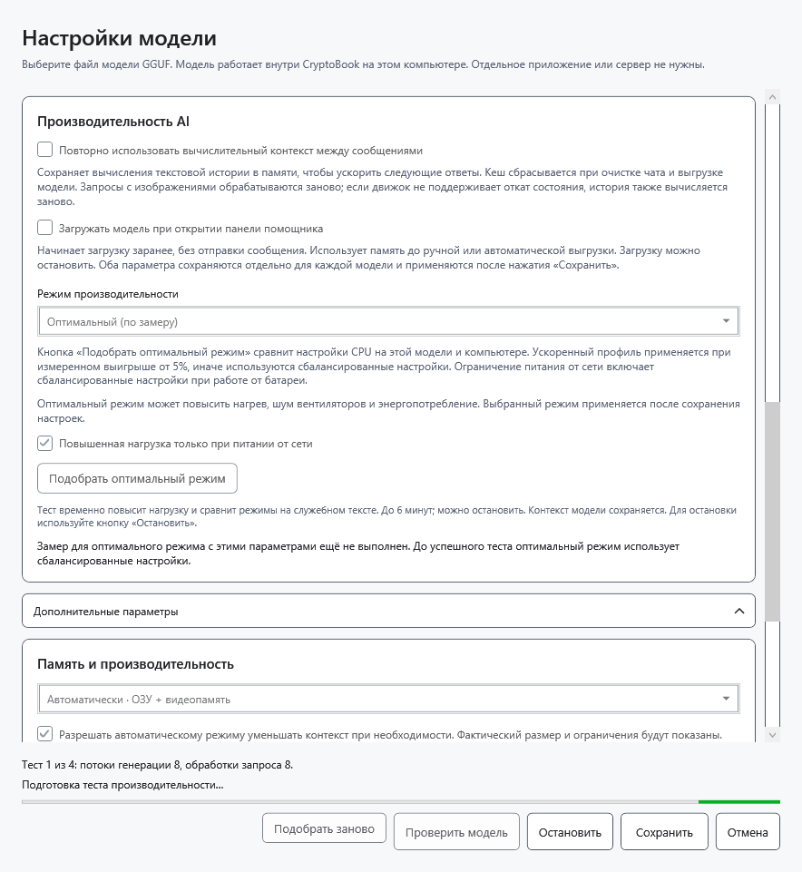
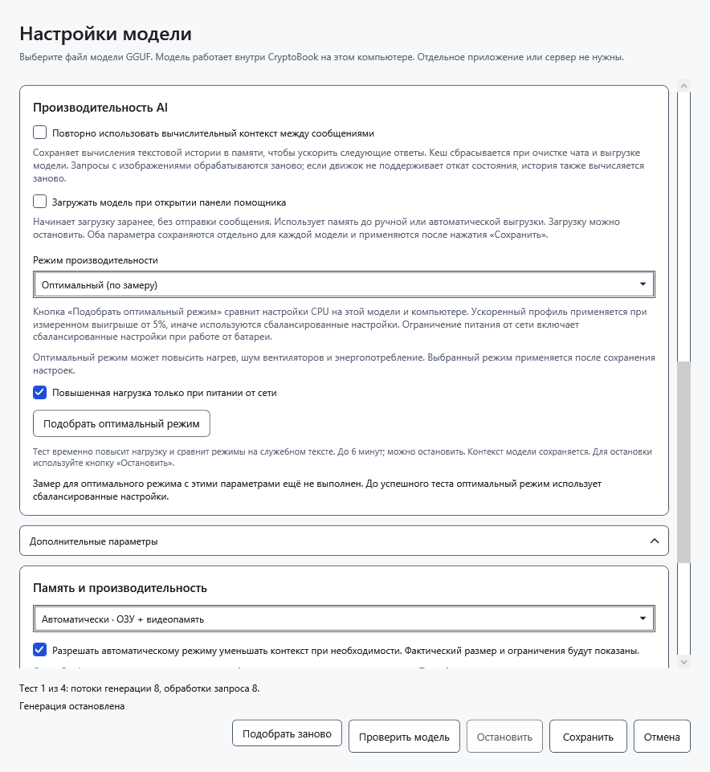
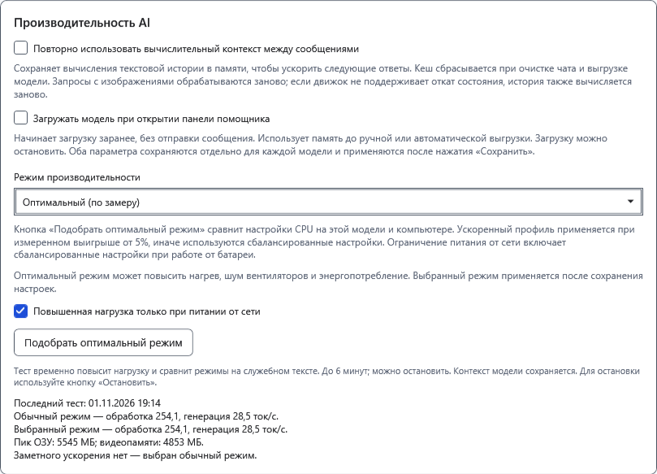

# Производительность AI и замер

Режим выбирается добровольно и сохраняется отдельно для файла модели. Ускорение зависит от оборудования, модели, контекста и текущей нагрузки. Более высокая нагрузка не гарантирует более быстрый ответ.

## Выбрать режим

1. Откройте **Настройки модели → Производительность AI → Режим производительности**.
2. Выберите **Сбалансированный** для обычной работы. **Экономичный** уменьшает число потоков и применяет энергосберегающее планирование Windows. Это не жёсткий предел мощности GPU и не обещание конкретного времени работы от батареи.
3. Нажмите **Сохранить** и отправьте короткий вопрос. В **Работа модели** виден действующий профиль. Смена режима сохраняет переписку и черновик, но освобождает прежний worker; следующий запрос загружает модель заново.

## Подобрать оптимальный режим

Сначала завершите текущий ответ. Во время теста возможны повышенные нагрузка, нагрев и шум; не запускайте несколько замеров одновременно.

4. В окне настроек выберите **Оптимальный (по замеру)**. По умолчанию включено **Повышенная нагрузка только при питании от сети**. При питании от батареи это ограничение блокирует повышенную нагрузку; не отключайте его без осознанного решения.
5. Нажмите **Подобрать оптимальный режим**. До **Сохранить** режим в чате не меняется. Замер прогревает модель, сравнивает обычный профиль с доступными вариантами повышенной нагрузки и может занять до шести минут. Он проверяет выбранный контекст без автоматического уменьшения.

6. При необходимости нажмите **Остановить**. Рабочий процесс теста освобождается; можно снова нажать **Подобрать оптимальный режим**. Остановка не считается успешным измерением.

7. Прочитайте результат: скорости обработки входа и генерации, сравнение обычного и выбранного профилей. Повышенная нагрузка выбирается лишь при измеренном выигрыше не меньше 5%; иначе сохраняется обычный профиль. Числа относятся к этому замеру и не обещают ту же скорость для длинного чата или изображений.

8. Нажмите **Сохранить**, чтобы применить выбранный режим к чату. Параметры питания и доступная память проверяются и при дальнейшей работе; при ограничениях повышенная нагрузка может не применяться.

## Повторить или вернуться

**Подобрать заново** удаляет сохранённые автоматический профиль и результат производительности для этой модели и заново проверяет модель. Это не загрузка обновлённых весов. После изменения модели или условий можно повторить замер. Простое нажатие **Подобрать оптимальный режим** также выполняет новый замер.

**Отмена** отбрасывает несохранённые параметры окна; уже выполненный замер мог обновить кеш результата. Для возврата к обычной работе выберите **Сбалансированный** и сохраните. Переписка от самого замера не удаляется. При нехватке ресурсов тест прекращается или ограничивает кандидатов; не закрывает чужие программы. Уменьшите контекст, выберите меньшую модель или повторите позже. В режиме CPU/GPU итог может отличаться.

- [Размещение в памяти](help:ai.memory)
- [Контекст](help:ai.context)
- [Загрузка и остановка](help:ai.lifecycle)
- [Ошибки помощника](help:ai.troubleshoot)
