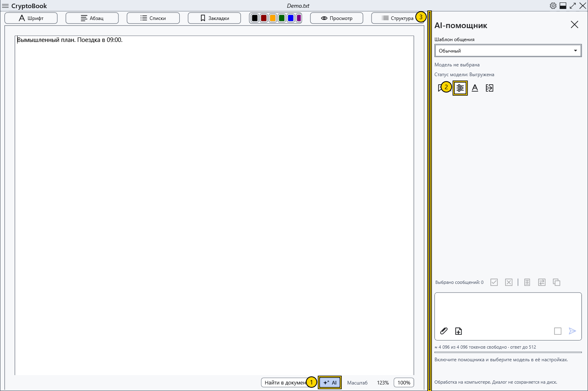

# Включить локального AI-помощника

Помощник отвечает в правой панели и обрабатывает запросы локальной моделью на вашем компьютере. Для работы не нужен отдельный сервер. Файлы модели и vision-проектора в поставку CryptoBook не входят: подготовьте их отдельно.

## Открыть и включить

1. Откройте обычный документ и нажмите **AI** внизу редактора (1). Для другого состояния окна используйте **Настройки → AI-помощник** и команду открытия панели.
2. В правой панели нажмите значок шестерёнки **Настройки модели** (2). Окно также доступно через **Настройки → AI-помощник → Настройки модели**.
3. Отметьте **Включить AI-помощника**, выберите языковой GGUF и нажмите **Сохранить**. Подробности — в статье о модели.

4. Введите вымышленный пробный вопрос и нажмите **Отправить** или Ctrl+Enter в поле запроса. Дождитесь текста ответа; проверьте его перед использованием.

## Результат и возврат

В панели видны имя выбранной модели, **Статус модели** и причина недоступности отправки. Включённый помощник ещё не означает загруженную модель: обычно она загружается при первом запросе. Если **Отправить** недоступна, прочитайте пояснение под полем ввода.

Перетащите левую границу панели (3), чтобы изменить ширину. Размер сохраняется при закрытии и повторном открытии панели и ограничивается свободным местом окна. Повторное нажатие **AI** скрывает панель. Скрытие не очищает чат и обычно не выгружает модель; для освобождения памяти нажмите **Выгрузить модель**. Незавершённая предзагрузка при скрытии отменяется.

Чтобы отключить помощник, снимите **Включить AI-помощника** в настройках. Это останавливает работу модели и очищает текущий диалог. Чат, черновик и вложения хранятся в памяти: они не архивируются между запусками и удаляются при очистке или сбросе ключа. Параметры модели и шаблоны сохраняются отдельно от переписки. Локальная обработка не проверяет достоверность ответа и не даёт модели возможностей, которых у неё нет.

- [Выбрать и проверить модель](help:ai.models)
- [Загрузка, остановка и выгрузка](help:ai.lifecycle)
- [Если помощник не отвечает](help:ai.troubleshoot)
- [Чат и сообщения](help:ai.chat)
